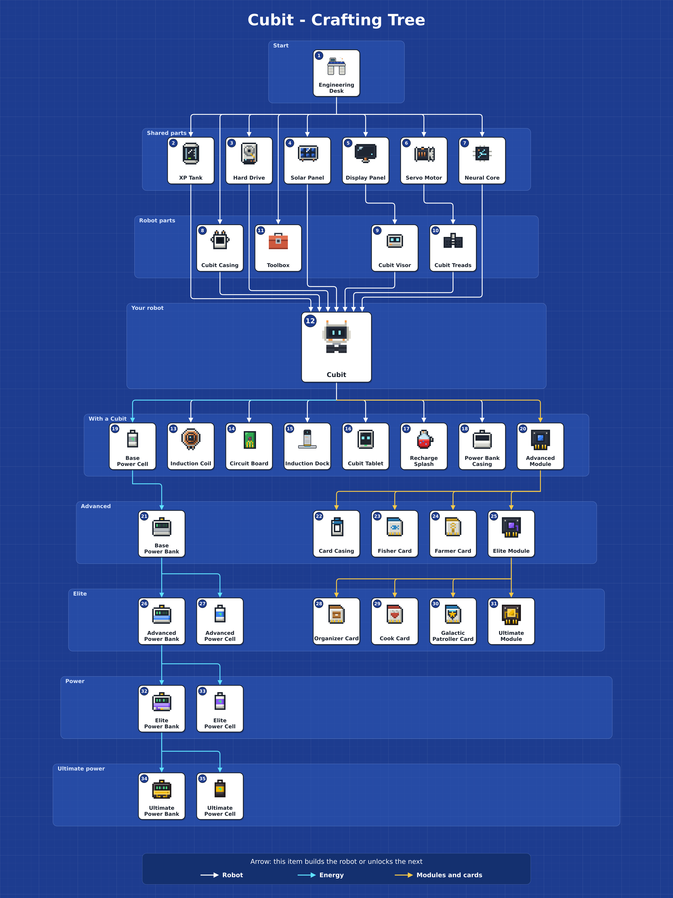
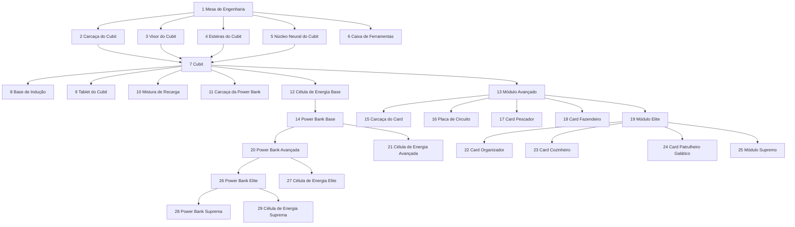

# Árvore de crafts

Este é o guia do player: o que fabricar primeiro, o que cada item libera e o que fazer quando algo aparece bloqueado. Os nomes estão em português, com o nome em inglês ao lado, porque o jogo mostra um ou outro conforme o idioma escolhido.

## Comece por aqui

1. **Faça a Mesa de Engenharia** na mesa de craft comum do jogo. É o único item do mod feito ali.
2. **Coloque a mesa** num lugar com 2 blocos livres lado a lado.
3. **Dê energia:** ponha pó ou bloco de redstone no slot de energia da mesa. Um pó de redstone paga 2 crafts.
4. **Ponha os materiais** na entrada da mesa, escolha a receita no catálogo e aperte **+** para pedir a quantidade. A mesa só fabrica depois do +.
5. **Faça as quatro peças** e, com elas, o **Cubit**.
6. **Pegue o Cubit.** Tê-lo libera a próxima etapa.

Para o primeiro Cubit, as quatro peças pedem, ao todo, 3 diamantes, 3 obsidianas, 7 lingotes de ferro, 2 pistões, 2 tochas de redstone e 4 pós de redstone. Guarde mais 3 pós de redstone para a energia da mesa. Nada disso vem do Nether.

### A receita da Mesa de Engenharia

| | Coluna 1 | Coluna 2 | Coluna 3 |
|---|---|---|---|
| Linha 1 | Painel de vidro | Redstone | Painel de vidro |
| Linha 2 | Baú | Mesa de craft | Baú |
| Linha 3 | Lingote de ferro | Lingote de ferro | Lingote de ferro |

## Como um item é liberado

- **Regra:** uma receita é liberada quando você **tem** o item que a libera, no seu inventário ou numa mesa que você abre. Basta tê-lo uma vez. Depois, a receita fica liberada para sempre, mesmo que você gaste o item.
- **Na mesa também conta:** ao abrir a mesa, os itens que estão na entrada e na saída dela também liberam as receitas para você.
- **Ver não é fabricar:** você pode abrir qualquer receita para ver os materiais. O que trava é o botão **+**.
- **Vale de qualquer jeito:** o item pode ter sido feito por você, achado ou dado por um amigo.
- **Cada player libera o seu:** num servidor, o que um amigo liberou não vale para você.

## O mapa

Cada número é o da [legenda](#legenda). A seta vai do item para o que ele libera. A imagem mostra os nomes em inglês, com os cards abreviados, e o diagrama abaixo dela, os nomes em português.

## Legenda

A mesa monta a receita sozinha, então você só precisa dos materiais, sem decorar a posição deles.

### Etapa 1: o começo

| Nº | Item | Materiais | Liberado por | Para que serve |
|---|---|---|---|---|
| 1 | Mesa de Engenharia (Engineering Desk) | A receita acima | Nada, na mesa de craft | Fabrica todo o resto do mod |
| 2 | Carcaça do Cubit (Cubit Casing) | 4 ferros, 2 obsidianas e 2 tochas de redstone | Nada, já vem liberada | Peça do Cubit |
| 3 | Visor do Cubit (Cubit Visor) | 2 diamantes e 1 obsidiana | Nada, já vem liberado | Peça do Cubit |
| 4 | Esteiras do Cubit (Cubit Treads) | 3 ferros e 2 pistões | Nada, já vêm liberadas | Peça do Cubit |
| 5 | Núcleo Neural do Cubit (Cubit Neural Core) | 1 diamante e 4 redstones | Nada, já vem liberado | Peça do Cubit e do Módulo Avançado |
| 6 | Caixa de Ferramentas (Toolbox) | 7 ferros, 1 redstone e 1 obsidiana | Nada, já vem liberada | Conserta o Cubit que morreu |
| 7 | Cubit | As peças 2, 3, 4 e 5 | Nada, já vem liberado | O seu robô companheiro |

### Etapa 2: com o Cubit

| Nº | Item | Materiais | Liberado por | Para que serve |
|---|---|---|---|---|
| 8 | Base de Indução (Induction Dock) | 1 diamante, 1 baú, 2 ferros e 1 redstone | 7 Cubit | Recarrega e cura o Cubit |
| 9 | Tablet do Cubit (Cubit Tablet) | 2 painéis de vidro, 1 redstone, 4 quartzos, 1 diamante e 1 obsidiana | 7 Cubit | Comanda os Cubits de longe |
| 10 | Mistura de Recarga (Recharge Splash) | 1 garrafa de vidro, 1 bloco de redstone, 1 ferro, 1 pólvora e 1 lápis-lazúli | 7 Cubit | Arremessada, recupera um pouco da vida e da energia dos seus Cubits |
| 11 | Carcaça da Power Bank (Power Bank Casing) | 6 quartzos, 1 ouro e 1 obsidiana | 7 Cubit | Peça das Power Banks |
| 12 | Célula de Energia Base (Base Power Cell) | 2 cobres, 2 redstones e 1 bloco de redstone | 7 Cubit | Peça da Power Bank Base |
| 13 | Módulo Avançado (Advanced Module) | 1 Núcleo Neural (5), 2 lápis-lazúlis e 2 ouros | 7 Cubit | Sobe o Cubit, a Base de Indução ou a Mesa de Engenharia para o Avançado |

### Etapa 3: com o Módulo Avançado ou a primeira célula

| Nº | Item | Materiais | Liberado por | Para que serve |
|---|---|---|---|---|
| 14 | Power Bank Base (Base Power Bank) | 11 e 12 | 12 Célula de Energia Base | Bateria portátil |
| 15 | Carcaça do Card (Card Casing) | 4 quartzos e 2 lápis-lazúlis | 13 Módulo Avançado | Peça de todo card de trabalho |
| 16 | Placa de Circuito (Circuit Board) | 5 esmeraldas, 1 comparador e 3 ouros | 13 Módulo Avançado | Peça de todo card de trabalho |
| 17 | Card Pescador (Machine Learning: Fisher) | 15, 16 e 1 vara de pescar | 13 Módulo Avançado | O Cubit pesca. Pede um Cubit Avançado |
| 18 | Card Fazendeiro (Machine Learning: Farmer) | 15, 16 e 1 enxada de ferro | 13 Módulo Avançado | O Cubit cuida da plantação. Pede um Cubit Avançado |
| 19 | Módulo Elite (Elite Module) | 1 Módulo Avançado (13), 2 corantes roxos e 2 diamantes | 13 Módulo Avançado | Sobe do Avançado para o Elite |

### Etapa 4: com o Módulo Elite ou a primeira Power Bank

| Nº | Item | Materiais | Liberado por | Para que serve |
|---|---|---|---|---|
| 20 | Power Bank Avançada (Advanced Power Bank) | 14, 2 lápis-lazúlis e 2 ouros. Ou 11 e 21 | 14 Power Bank Base, ou 21 para a segunda receita | Bateria portátil maior |
| 21 | Célula de Energia Avançada (Advanced Power Cell) | 12, 2 lápis-lazúlis e 2 ouros | 14 Power Bank Base | Peça da Power Bank Avançada |
| 22 | Card Organizador (Machine Learning: Organizer) | 15, 16 e 1 funil | 19 Módulo Elite | O Cubit organiza baús. Pede um Cubit Elite |
| 23 | Card Cozinheiro (Machine Learning: Cook) | 15, 16 e 1 defumador | 19 Módulo Elite | O Cubit cozinha. Pede um Cubit Elite |
| 24 | Card Patrulheiro Galático (Machine Learning: Galactic Patroller) | 15, 16 e 1 estrela de fogo de artifício | 19 Módulo Elite | O Cubit protege o lugar. Pede um Cubit Elite |
| 25 | Módulo Supremo (Ultimate Module) | 1 Módulo Elite (19), 2 lingotes de netherita e 2 varas de blaze | 19 Módulo Elite | Sobe do Elite para o Ultimate |

### Etapa 5: as maiores Power Banks

| Nº | Item | Materiais | Liberado por | Para que serve |
|---|---|---|---|---|
| 26 | Power Bank Elite (Elite Power Bank) | 20, 2 corantes roxos e 2 diamantes. Ou 11 e 27 | 20 Power Bank Avançada, ou 27 para a segunda receita | Bateria portátil ainda maior |
| 27 | Célula de Energia Elite (Elite Power Cell) | 21, 2 corantes roxos e 2 diamantes | 20 Power Bank Avançada | Peça da Power Bank Elite |
| 28 | Power Bank Suprema (Ultimate Power Bank) | 26, 2 lingotes de netherita e 2 varas de blaze. Ou 11 e 29 | 26 Power Bank Elite, ou 29 para a segunda receita | A maior bateria portátil |
| 29 | Célula de Energia Suprema (Ultimate Power Cell) | 27, 2 lingotes de netherita e 2 varas de blaze | 26 Power Bank Elite | Peça da Power Bank Suprema |

## Fabricação em cascata: a mesa faz tudo sozinha

Com a Mesa de Engenharia no tier **Ultimate**, você não precisa mais pedir peça por peça. Escolha o item final, e a mesa faz todas as peças na ordem certa. Nos outros tiers, a aba aparece apagada.

1. **Abra a aba Cascata (Cascade)** e escolha um item no catálogo. Ele e todas as peças dele precisam estar liberados para você.
2. **Escolha a quantidade** com − e +. Com Shift, muda de 8 em 8.
3. **Veja os materiais:** verde, a entrada tem o bastante; amarelo, tem só uma parte; vermelho, não tem. Passe o mouse para ver quanto há. O que falta, ponha na aba Estoque e volte: a escolha continua.
4. **Aperte Ver plano (View plan),** que acende com tudo verde. A tabela mostra cada tarefa, quantos materiais ela usa, de quais tarefas depende, a energia e o tempo.
5. **Aperte Iniciar (Start)** e confirme. **Não dá para cancelar depois.**

Enquanto o plano roda, a mesa fica travada nessa aba, para todos. Só o slot de energia continua livre, e os funis continuam trabalhando. Sem energia ou com sinal de redstone, o plano pausa e volta sozinho.

- **Peças prontas:** as que já estão na entrada ou na saída são aproveitadas, e você gasta menos.
- **Saída cheia:** o plano termina assim mesmo, e o que não couber sai quando houver espaço.
- **Mesa quebrada no meio:** o item da mesa guarda o plano e os materiais, e ele continua quando você a coloca de novo.

## Receitas de ajuda

Não são itens novos, então não têm número no mapa.

| Receita | Materiais | Liberada por |
|---|---|---|
| Religar um Cubit sem bateria | O Cubit e qualquer Power Bank. A Power Bank volta com a carga que sobrou | Qualquer Power Bank |
| Consertar um Cubit que morreu | O Cubit Danificado (Damaged Cubit) e a Caixa de Ferramentas (6), que é gasta | O Cubit Danificado ou a Caixa de Ferramentas |

## Dúvidas comuns

**Uma receita aparece escura, com um cadeado e `Locked` (Bloqueada). Por quê?**
Você ainda não teve o item que a libera. Passe o mouse sobre ela: a dica diz qual é, como `Liberada com: Cubit`. Você também pode procurá-la na legenda, na coluna "Liberado por".

**Uma receita aparece escura, mas sem cadeado.**
Ela já está liberada, e faltam materiais na mesa.

**O botão + está cinza.**
Passe o mouse sobre ele. A dica diz o que falta: o item que libera a receita ou os materiais, como `Falta: 2 Diamante`. Na grade, o que você tem fica verde e o que falta fica vermelho, conforme a quantidade pedida. Basta ter os de uma unidade, na entrada ou na saída da mesa. Depois que o pedido começa, o + fica livre.

**Fiz o item, e o seguinte continua bloqueado.**
Feche e abra a mesa. Se continuar, avise a equipe do mod.

**Num mundo novo, até o Cubit e as peças aparecem bloqueados.**
Isso não é o esperado: elas já vêm liberadas. Avise a equipe do mod e diga se há outros mods no jogo. Enquanto isso, quem pode usar comandos libera a receita com `/recipe give @s cubit:general_robot`, ou todas com `/recipe give @s *`.

**A mesa não começa a fabricar.**
Confira, nesta ordem: se você apertou **+** para pedir a quantidade, se há energia, se os materiais acabaram no meio do pedido, se há espaço na saída e se a mesa não recebe sinal de redstone, que a pausa. A tela mostra o motivo.

**O Ver plano ou o Iniciar está apagado.**
Passe o mouse sobre ele. O motivo pode ser material que falta na entrada, um pedido ativo na aba Projeto ou itens do último plano que ainda não saíram.

**As abas Projeto e Estoque estão com um cadeado.**
Há uma fabricação em cascata em andamento. Elas abrem quando ela terminar.

**Em que dimensão consigo os materiais?**
O primeiro Cubit, a Base de Indução e o Módulo Avançado só usam materiais do Overworld. O Tablet, as peças das Power Banks e a peça dos cards pedem quartzo, e a netherita e a vara de blaze, do tier Ultimate, vêm do Nether.

**O card não entra no Cubit.**
Cada card pede um tier mínimo do Cubit: Avançado para o Pescador e o Fazendeiro, e Elite para os demais. O Cubit Base não aceita cards.

**Preciso ter o Módulo Elite para fabricar o Supremo?**
Sim, e ele é gasto na receita. Se também quer subir um Cubit para o Elite, faça outro Módulo Elite.

**Se eu gastar o item que liberou a receita, ela bloqueia de novo?**
Não. Depois de liberada, fica liberada.

**Vejo a receita no JEI, mas não consigo fazê-la.**
O JEI mostra todas as receitas, também as bloqueadas. Quem decide é a mesa.

## Histórico de modificações

| Pessoa | Data e hora | Modificação |
|---|---|---|
| Zennd | 2026-11-23 16:20 | Explica a fabricação em cascata (pergunta 2006). |
| Zennd | 2026-11-23 12:39 | Explica as cores da grade pela quantidade (pergunta 1996). |
| Zennd | 2026-11-23 12:17 | Explica o +, a dica do que falta e os itens dentro da mesa (perguntas 1969 a 1992). |
| Zennd | 2026-11-23 11:57 | Acrescenta a imagem da árvore (pergunta 1976). |
| Zennd | 2026-11-23 11:36 | Cria o guia da árvore de crafts para o player (perguntas 1951, 1965 e 1975). |
