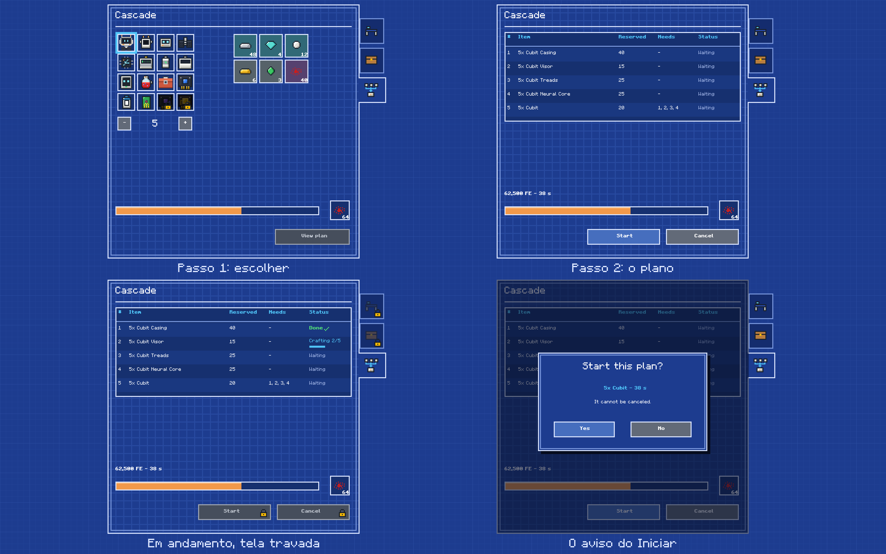

# Fabricação em cascata

O recurso exclusivo da Engineering Desk no último tier: o player escolhe um item e a quantidade, e a mesa faz sozinha todos os sub-crafts até ele. O conceito é do desenvolvedor (perguntas 1964 e 2006) e foi refinado nas perguntas 2007 a 2029. A mesa está em [`mesa-de-engenharia.md`](mesa-de-engenharia.md).

**Situação:** autorizado (pergunta 2031), na issue #253. O ícone da aba e a prancha da tela já foram aceitos (pergunta 2030).

## Por quê

Hoje, para fazer 5 Cubits, o player pede cada peça, uma por uma. No Ultimate, ele pede os 5 Cubits e deixa a mesa fazer as 25 peças e Cubits na ordem certa.

## A aba

- **Nome:** `Cascade` / `Cascata`, com um ícone de 16×16 próprio (perguntas 2018 e 2029).
- **Outros tiers:** no Base, no Avançado e no Elite aparece apagada, com `Unlocks at Ultimate`. A liberação é a chave por tier `engineering_desk_cascade`, ligada só no Ultimate, para o pack poder mudar (regra 39 e pergunta 2020).
- **Dois passos,** na mesma aba, no azul de prancheta da mesa (pergunta 2017).

As prévias da tela real, aprovadas na pergunta 2044, são a referência do código: o cabeçalho das outras abas, os botões acima da barra de energia, a tabela na largura toda, sem o catálogo, e um ícone em cada linha. A prancha ficou como referência de estilo (pergunta 2030). Duas coisas mudam nela: o inventário do player aparece embaixo, como nas outras abas, e o verde, o amarelo e o vermelho ficam mais fortes, porque sobre o fundo azul o amarelo virava cinza. Os materiais do painel 1 são só ilustrativos.

### Passo 1: escolher

- **Catálogo:** os 28 itens de receita fixa da mesa, sem o upgrade de Power Bank, o religar e o conserto. A Power Bank sai pela carcaça com a célula. Só pode ser escolhido o item com ele e **toda a cadeia dele** liberados para o player, e o resto aparece com cadeado e a dica do que falta liberar. Um item liberado aparece normal, também sem materiais, porque a mesa faz as peças (perguntas 1991, 2009 e 2038).
- **Packs:** com duas receitas para o mesmo item, vale a primeira na ordem do catálogo, sem as com estado. Com material alternativo, como uma tag, o plano pede o que houver mais na entrada e, sem nenhum, o primeiro da lista. Um item com receitas em ciclo aparece com cadeado e a dica do motivo, e nunca trava o jogo (perguntas 2032 a 2034).
- **Quantidade:** − e +, com Shift de 8 em 8, de 1 ao maior pedido do tier, 256 (pergunta 2011).
- **Materiais:** um slot por item vanilla de base da cascata, com a quantidade e um véu transparente, forte o bastante para as três cores se distinguirem sobre o azul (perguntas 2006 e 2045):
  - **verde:** a entrada tem o bastante;
  - **amarelo:** a entrada tem, mas não o bastante;
  - **vermelho:** a entrada não tem.
- **Dica do slot:** o nome do item e quanto há na entrada.
- **Peças prontas:** as do mod que já estão na entrada ou na saída são aproveitadas, e os materiais vanilla, o FE e as tarefas diminuem (pergunta 2008).
- **Recalcula** a cada mudança de item, de quantidade ou da entrada. O player pode ir à aba Estoque, pôr o que falta e voltar, com a escolha mantida. Ela vale só enquanto a tela está aberta, uma por player, e nada é salvo antes do Iniciar (pergunta 2021).
- **Ver plano:** acende com todos os materiais verdes. Apagado, a dica diz o motivo.

### Passo 2: o plano

- **Tabela,** uma linha por item, na ordem de execução (perguntas 2012 e 2024):

| Coluna | Mostra |
|---|---|
| Ordem | O número da tarefa |
| Item | O nome e a quantidade, como `5× Cubit Casing` |
| Reservados | Quantos materiais a tarefa consome ao todo, com a lista na dica |
| Depende de | Os números das tarefas que precisam terminar antes |
| Status | Aguardando, processando, com o progresso, como `2/5`, ou concluído |

  Para 5 Cubits: 1 a 4, as peças, sem dependência, e 5, os Cubits, que dependem de 1, 2, 3 e 4.

- **Energia e tempo:** o FE total e o tempo estimado do plano. Não são exigidos para iniciar (pergunta 2013).
- **Sem material:** se os materiais saírem da entrada com o passo 2 aberto, ele fica à vista, com o Iniciar apagado e o motivo na dica, e o Iniciar acende de novo se eles voltarem (pergunta 2046).
- **Cancelar:** volta ao passo 1. Só existe antes do Iniciar.
- **Iniciar:** pede uma confirmação, Sim e Não, com o item, a quantidade, o tempo e o aviso de que não dá para cancelar (pergunta 2023). Só inicia sem pedido ativo na aba Projeto (pergunta 2015). O servidor confere tudo de novo (regra 19).

## O plano em andamento

- **Reserva:** ao Iniciar, os materiais e as peças aproveitadas saem de uma vez da entrada e da saída para o **estoque próprio do plano**, que funis, canos e players não alcançam. As peças intermediárias também ficam nele, e só o item final vai à saída. Nada some nem duplica (regra 13 e pergunta 2007).
- **Em série:** uma tarefa por vez, uma unidade por craft, com o tempo e o FE de hoje do tier. 5 Cubits são 25 crafts, 62.500 FE e 37,5 s.
- **Não cancela:** os botões e as outras abas travam, com um cadeado dourado (pergunta 2044), e a mesa abre sempre nessa aba, só para ver, para todos os players. As abas Projeto e Estoque travam, e o + do JEI é recusado (perguntas 2006 e 2015).
- **Slot e barra de energia:** ficam nesta aba, usáveis também travada (pergunta 2013).
- **Pausa** sem FE ou com sinal de redstone, e volta sozinha (pergunta 2010).
- **Saída cheia não pausa:** os itens finais que não couberem, como Cubits, que não empilham, esperam no estoque do plano até haver espaço (pergunta 2028).
- **Automação:** os funis e canos continuam pondo na entrada e tirando da saída, sem tocar no plano (pergunta 2025).
- **Quem inicia:** qualquer player, como os outros usos da mesa. A progressão é a de quem inicia (pergunta 2016).
- **No mundo:** o brilho, o braço, os sons e o holograma de hoje, com o item da tarefa. O Jade mostra `Cascade: Cubit · 12/25`, e o comparador lê o que falta do plano, de 15 a 0 (pergunta 2022).

## Fim

- **Concluído:** as abas destravam na hora. A aba Cascade mostra o plano concluído, com o botão Novo plano, que volta ao passo 1 (pergunta 2019).
- **Sobra no estoque:** os itens finais que não couberam continuam saindo para a saída conforme abre espaço. Um plano novo só inicia com o estoque vazio.
- **Impossível:** se uma receita do plano sumir ou mudar num pack, o plano encerra, e tudo o que está reservado volta à entrada ou à saída. O que não couber espera no estoque do plano, como a sobra (pergunta 2010).
- **Quebrar a mesa:** o item guarda o plano, com o estoque, e ele continua ao ser colocada. A dica do item mostra o plano, como `Cascade: Cubit · 12/25`, e conta os itens do estoque. Com o estoque do plano cheio de itens, vale a regra de não aninhar (perguntas 1481 e 2010).

## Detalhes completados pelo agente

Não foram perguntados e foram autorizados junto do conceito (pergunta 2031):

1. A dica do passo 1 mostra também as peças aproveitadas, como `Using: 2× Cubit Casing` / `Aproveitando: 2× Carcaça do Cubit`.
2. A ordem das tarefas é a da árvore: primeiro as que não dependem de nada, e uma peça usada por várias, como a Card Casing, vira uma tarefa só.
3. Um plano em andamento termina mesmo se a chave `engineering_desk_cascade` for desligada depois.
4. A tabela rola quando passa do tamanho da tela. A maior cadeia hoje é a da Ultimate Power Bank, com 6 crafts por unidade.
5. O plano guarda as tarefas pelo ID da receita, com a quantidade feita, e o estoque, no save e no item da mesa.

## Contrato

| Onde | Nome | Conteúdo |
|---|---|---|
| Config, por tier | `engineering_desk_cascade` | Desligada no Base, no Avançado e no Elite, e ligada no Ultimate |
| NBT da mesa | `Cascade` | O item, a quantidade, as tarefas e o estoque do plano, com um plano em andamento, com o resultado do último à vista ou com sobra. Sem a chave, nenhum plano |
| Item da mesa | `cubit:engineering_desk_cascade` | O mesmo conteúdo, num data component opcional |
| Traduções | A aba, os botões, a tabela, os status, as dicas, o aviso e o Jade | Em inglês e português, com as mesmas chaves (regra 1) |

Nenhum save antigo muda: uma mesa sem a chave não tem plano (regra 18).

## Entrega

Uma issue e dois PRs (pergunta 2026):

1. **PR 1:** o cálculo do plano em `domain/`, o estoque, o andamento, as pausas, o fim, os saves, o config e os testes, com uma tela simples: a aba com o catálogo, a quantidade, o Iniciar com a confirmação e a tabela em texto, já travando a mesa (pergunta 2035).
2. **PR 2:** a tela dos dois passos, com as cores, a tabela, o aviso e o ícone, o Jade, o JEI e o guia do player.

## Fora do escopo

- Os outros tiers, as receitas com estado e a fila de vários planos.
- Um visual e sons próprios do plano no mundo.

## Histórico de modificações

| Pessoa | Data e hora | Modificação |
|---|---|---|
| Zennd | 2026-11-23 16:20 | Detalha a tela do PR 2, a dica do item e o passo 2 sem material (perguntas 2042 a 2046). |
| Zennd | 2026-11-23 14:22 | Nomeia o data component do plano no contrato. |
| Zennd | 2026-11-23 14:10 | Acrescenta as regras dos packs e a tela simples do PR 1 (perguntas 2032 a 2035). |
| Zennd | 2026-11-23 13:57 | Registra a autorização e a prancha da tela (perguntas 2030 e 2031). |
| Zennd | 2026-11-23 13:44 | Cria o conceito da fabricação em cascata (perguntas 2006 a 2029). |
