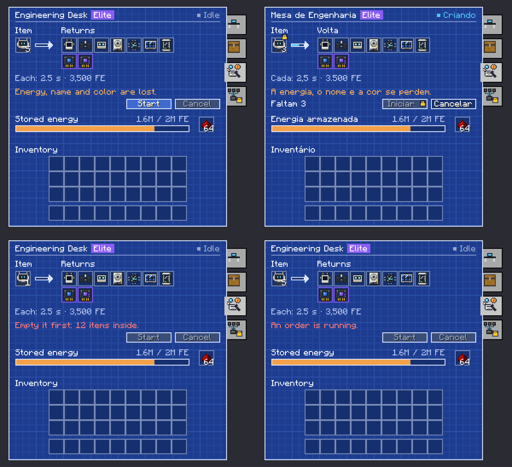

# Desmontar na mesa

Um recurso da Engineering Desk nos tiers Elite e Ultimate: o player põe um item do mod num slot e recebe de volta as peças do mod da receita dele. A ideia é do desenvolvedor (perguntas 2504 e 2505) e foi refinada nas perguntas 2522 a 2534. A mesa está em [`mesa-de-engenharia.md`](mesa-de-engenharia.md).

**Situação:** autorizado (pergunta 2535), na entrega 3 da Network (#265), com o ícone da aba aceito (pergunta 2536). Chega ao jogo só na `0.2.0`.

## Por quê

As peças do mod servem em receitas diferentes. Um Tablet a mais vira um Display Panel para o próximo Dock, e um card que não se usa mais devolve a Circuit Board e o Neural Core.

## O que desmonta

1. **Itens:** todo item do mod com uma receita da mesa, `cubit:engineering`, que usa outros itens do mod (pergunta 2526). Hoje são os Modules, as células e as Power Banks acima do Base, a Power Bank Base, a Power Bank Casing, as esteiras e o visor do Cubit, o Cubit, o Induction Dock, os cards, o Network Server, o Solar Relay, a Signal Antenna, o Tablet e o Transceiver.
2. **Nunca:** as receitas especiais, como o upgrade da Power Bank, o conserto e o religar, o Damaged Cubit, a própria mesa, feita na mesa de craft do jogo, e os itens só com materiais do jogo.
3. **Um nível:** o item volta às peças da receita dele, e o player desmonta cada peça para ir mais fundo (pergunta 2523).

## O que volta

1. **Só os itens do mod** da receita, na quantidade dela. Os itens do jogo não voltam (pergunta 2504).
2. **Modules:** um item que subiu de tier devolve também um Module de cada tier aplicado até o atual. Um Cubit Elite devolve as peças, o Advanced Module e o Elite Module (pergunta 2525).
3. **Packs:** como na cascata (pergunta 2032), vale a primeira receita na ordem do catálogo. Uma receita que rende N só desmonta com N itens no slot, e numa marca que aceita vários itens volta o primeiro da lista que for do mod. Montar e desmontar nunca criam itens (pergunta 2530).

## Item com conteúdo

1. **Recusa:** enquanto o item tiver itens, XP, card ou tochas dentro, como um Cubit com inventário ou um Dock com estoque, a mesa não desmonta e mostra o motivo (pergunta 2524).
2. **O que se perde:** a energia, o nome e a cor. A tela avisa antes de iniciar. Uma Power Bank carregada desmonta, e a carga se perde com o aviso.

## Como roda

1. **Slot próprio:** na aba Desmontar, como o de redstone. A mesa desmonta um por vez tudo o que estiver nele, até esvaziar. A automação não põe nesse slot (pergunta 2527).
2. **Tempo e custo:** os de um craft no tier da mesa, como 2,5 s e 3.500 FE no Elite, com os números de [`tiers.md`](../tiers.md#engineering-desk).
3. **Um trabalho por vez:** desmontar só inicia sem pedido e sem cascata, e o pedido e a cascata não iniciam durante a desmontagem, com o motivo na tela (pergunta 2528).
4. **Cancelar:** a desmontagem para, o item em andamento fica no slot, e nada se gasta, porque o FE sai só ao terminar cada unidade.
5. **Pausa:** as peças só saem se couberem todas na saída. Sem espaço, sem energia ou com sinal de redstone, pausa sem perder o progresso, mostra o motivo e volta sozinha (pergunta 2529).

## Tiers

Liberada no Elite e no Ultimate, pela chave `engineering_desk_disassembly`, por tier, ligada nesses dois por padrão (regra 3). Abaixo deles, a aba aparece com cadeado e a dica do tier, como a Cascade (pergunta 2531).

## A aba

1. **Nome:** `Disassemble`, em português `Desmontar`, com um ícone de 16×16 próprio (pergunta 2533).
2. **Tela:** o slot do item à esquerda, a seta de progresso e, à direita, o que volta, com as peças e os Modules. Embaixo ficam o aviso da energia, do nome e da cor, ou o motivo da recusa, os botões Iniciar e Cancelar, a barra de energia, o slot de redstone e o inventário do player, no azul de prancheta das outras abas. A prévia foi aprovada (perguntas 2534 e 2535).

## No mundo

Como o craft: o brilho, o braço e os sons de hoje, com o holograma do item que está sendo desmontado. O Jade mostra `Disassemble: Cubit · 3 left`, e o comparador lê o que falta, de 15 a 0, como no pedido. O JEI não muda (pergunta 2532).

## Detalhes propostos pelo agente

1. **Ordem das abas:** Projeto, Estoque, Desmontar e Cascade, na ordem do tier em que cada uma se libera.
2. **O slot aceita** só os itens que desmontam. Um item com conteúdo entra, e a tela mostra o motivo da recusa, para o player saber o que esvaziar.
3. **Slot travado:** durante a desmontagem, o slot não aceita nem entrega itens. O Cancelar o destrava.
4. **Atômico:** ao fim de cada unidade, no mesmo tick, a mesa tira um item do slot, põe todas as peças na saída e gasta o FE (regra 13 e pilar Defesa). O conteúdo é conferido de novo nesse momento.
5. **Quebrar a mesa:** o item do slot e a desmontagem em andamento vão no item da mesa, como o pedido, e continuam ao colocá-la. Com o slot cheio, vale a regra de não aninhar.
6. **O que volta, na tela:** as peças em slots só de leitura, com a quantidade de uma unidade, como na receita. Os Modules aparecem depois das peças.

## Contrato

| Onde | Nome | Conteúdo |
|---|---|---|
| Config, por tier, em `[general_robot.{tier}]` | `engineering_desk_disassembly` | Se a aba fica liberada. Desligada no Base e no Advanced, ligada no Elite e no Ultimate |
| NBT da mesa | `Disassembly` | O item do slot, se está rodando e o progresso. Sem a chave, slot vazio e parada |
| Item da mesa | O estado guardado da mesa | Leva o `Disassembly`, como o pedido |
| Textura | `textures/gui/disassemble_tab.png` | O ícone da aba |

## Recursos

1. **Ícone da aba:** gerado pelo prompt de `tmp/arte/desmontar/prompt.md` e aceito (pergunta 2536).
2. **Sons:** nenhum novo (pergunta 2532).

## Histórico de modificações

| Pessoa | Data e hora | Modificação |
|---|---|---|
| Zennd | 2026-11-26 07:23 | Acrescenta a Signal Antenna à lista dos itens (pergunta 2576). |
| Zennd | 2026-11-25 21:20 | Registra a autorização, a prévia da tela e o ícone aceito (perguntas 2535 e 2536). |
| Zennd | 2026-11-25 21:15 | Cria o conceito de desmontar na mesa (perguntas 2504, 2505 e 2522 a 2534). |
