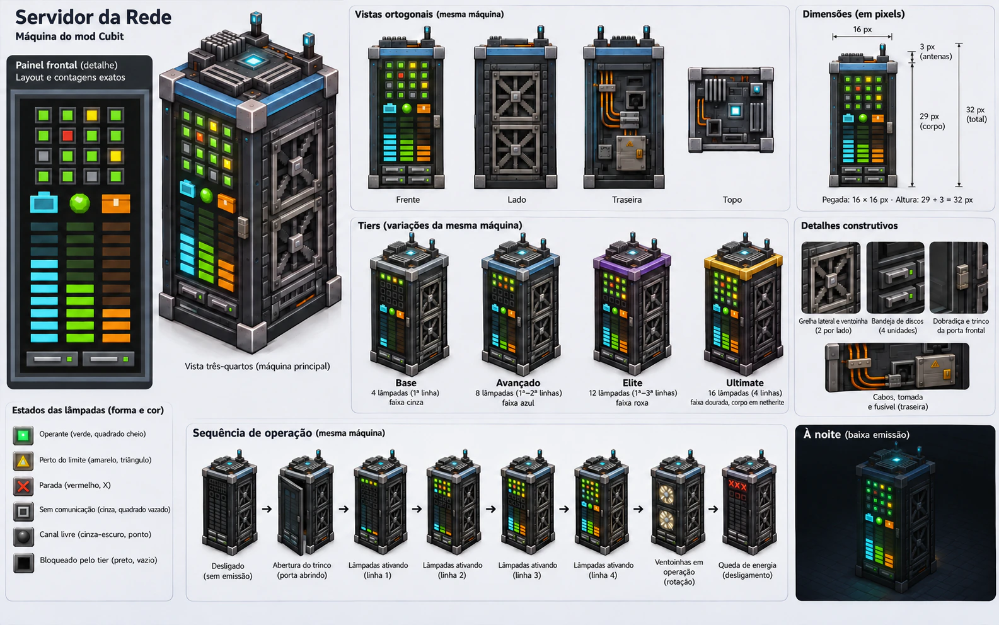
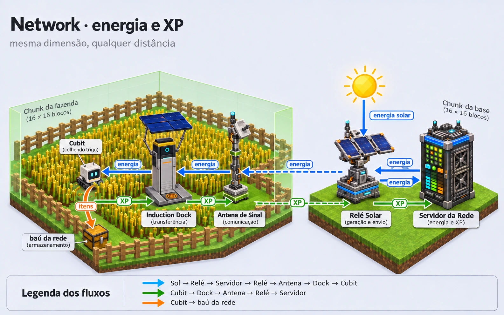

# Network

A rede sem fio do mod: o Network Server, o Solar Relay e a Signal Antenna. O conceito é do desenvolvedor e foi refinado nas perguntas 2196 a 2344, citadas só pelo número. As respostas em [`perguntas/`](../perguntas/fase-5-trabalhos.md) prevalecem. As entregas estão no [`ROADMAP.md`](../../ROADMAP.md#network-a-rede-sem-fio-em-conceito).

**Situação:** conceito autorizado (pergunta 2325). O código espera a autorização própria do desenvolvedor (pergunta 2224). Os números entram em [`tiers.md`](../tiers.md) e no config na Entrega 1.

## A ideia

O player põe um Network Server e um Solar Relay na base e leva antenas aos lugares de trabalho. A rede leva energia até as antenas, sem cabo, as antenas mantêm os chunks carregados e alimentam os Docks, e o XP faz o caminho inverso. O Cubit trabalha longe do player, dentro dos chunks das suas antenas. Funciona numa instância só com o mod, com redstone e sol (regra 50).

## As peças

| Peça | ID | Português | O que faz |
|---|---|---|---|
| Network Server | `cubit:network_server` | Servidor da Rede | Centro da rede: guarda FE, XP e itens e carrega o próprio chunk |
| Solar Relay | `cubit:solar_relay` | Relé Solar | Gera com o sol e é o rádio do Servidor |
| Signal Antenna | `cubit:signal_antenna` | Antena de Sinal | Carrega o chunk, recebe energia e liga Cubits, Docks e baús |
| Transceiver | `cubit:transceiver` | Transceptor | Peça compartilhada |
| Chunk Anchor | `cubit:chunk_anchor` | Âncora de Chunk | Peça compartilhada |

Servidor, Relay e antena têm Rename e o nome padrão com 8 dígitos (2275). Todos só do dono, com o servidor do jogo conferindo (2259). Explosão e pistão não os afetam. Precisam de um topo sólido para ser colocados e não caem se ele sumir (2255).

## Regras da rede

1. **Um de cada por chunk, de qualquer dono:** um Servidor, um Solar Relay e uma antena. Quem chega depois é recusado, com o motivo (2271).
2. **Par:** o Servidor e o Solar Relay se pareiam sozinhos, no mesmo chunk e do mesmo dono. Sem Relay, a rede não transmite. Coberto ou sem sol, ele transmite (2268).
3. **Canais:** 16, um por antena, na ordem dos IDs em inglês: black, blue, brown, cyan, gray, green, light_blue, light_gray, lime, magenta, orange, pink, purple, red, white e yellow (2269). Abertos por tier: 4, 8, 12 e 16. O player troca o canal na tela da antena, entre os livres abertos (2309). O canal só é ocupado ao colocar a antena (2301).
4. **Dimensão:** a rede não atravessa dimensões. Um vínculo com outra é recusado, com aviso.
5. **Alcance:** qualquer distância na dimensão (2260).
6. **Quem manda:** todo vínculo e toda tela, só o dono do Servidor, da antena, do Cubit e do Dock. Os storages do chunk valem, se o player consegue abri-los (2259).

## Energia

| Número | Valor |
|---|---|
| Geração do Relay, de dia, pelo tier do Servidor | 500, 1.000, 2.000 e 4.000 FE/t (2220) |
| De noite | Só com Servidor Ultimate, 25%, 1.000 FE/t. Nada na chuva (2223) |
| Bateria do Servidor | 1,2, 4,8, 24 e 64 milhões de FE (2222) |
| Bateria do Relay e da antena | 300 mil e 600 mil FE (2289 e 2273) |
| Chunk, por tick, no Servidor e na antena | 25 FE (2216) |
| Distância do Servidor à antena, por tick | 1 FE por 500 blocos completos além dos 100, também com a chave do chunk desligada (2310 e 2321) |
| Servidor, distribuindo | 20, 40, 80 e 160 mil FE/t. Cada antena, até 5.000 (2276) |
| Entrada por cabo e redstone | Servidor: 20, 40, 80 e 160 mil FE/t. Solar Relay e antena: 5.000 FE/t (2326) |

- **Entrada:** sol, redstone, Power Bank e cabo, em todos os três blocos (2256 e 2263). Nenhuma energia sai por cabo.
- **Caminho:** sol e Servidor, Solar Relay, antena, Dock, Cubit. O sol vai direto ao Servidor, para a energia não ir e voltar (detalhe 18).
- **Energia curta:** primeiro o gasto do chunk de cada antena, na ordem dos canais, e o resto por igual. Em cada antena, os Docks com Cubit carregando antes dos vazios (2302).
- **Dock:** a rede entra depois do sol, no limite de entrada de 5.000 FE/t (detalhe 19).

## Chunks

1. **Um chunk por antena,** o dela (2199). O Servidor carrega o dele (2264: a antena no chunk do Servidor não paga de novo).
2. **Vale sem Cubit:** a antena carrega o chunk mesmo sem Cubit ligado, se vinculada ao Servidor e com FE (2211).
3. **Chave do chunk,** em cada bloco, ligada por padrão, só do dono, e também na tela do Servidor. Desligada, tudo funciona menos o carregamento, enquanto o chunk estiver carregado por outro meio (2211, 2213 e 2214).
4. **Limites:** 48 chunks por player e 192 no mundo, no config, com 0 para sem limite. Acima disso, a antena funciona sem segurar o chunk (2215).
5. **Config do mundo:** `chunk_loading_enabled` trava a chave, com o motivo (2214).
6. **Dono offline:** os chunks saem, e os Cubits hibernam com `Owner offline`, mesmo com o chunk carregado por outro player. Volta tudo quando ele entra (2210, 2274 e 2291).

### UPS / Nobreak

A reserva de bateria do Servidor e da antena, só para o próprio chunk. O player escolhe de 0% a 50%, de 5 em 5, e vê o tempo que ela segura. Padrão: 25% no Servidor e 50% na antena. Em 0%, avisa que o chunk pode cair (2209, 2212, 2219 e 2221). O nome é UPS em inglês e Nobreak em português (2218). Dentro da reserva, a antena segura o chunk e para de alimentar os Docks (detalhe 23). Além disso, a antena sempre guarda 5% da bateria, 30 mil FE, que nenhum Dock tira (2322).

### Queda e volta

- **Elo caído:** cada peça usa a bateria e só solta o chunk quando zera, com aviso (2208). A antena sem sinal com o Servidor por mais de 20 minutos para, mesmo recarregada com redstone (2323).
- **Para o Cubit,** a rede só cai com a antena zerada, desligada ou sem sinal por mais de 20 minutos (2296 e 2323).
- **Volta:** as antenas religam uma por vez, a cada 2 s, 40 ticks, no config (2209 e 2330).
- **Quebrar a antena:** libera o canal. No mesmo chunk, tudo volta. Em outro, as ligações dela se desfazem, com aviso. O item guarda o ID, o Servidor, a bateria e o XP (2252).
- **Trocar de Servidor:** o clique em outro Servidor do dono troca a ligação e zera as dos Cubits, com aviso (2307).
- **Quebrar o Servidor:** o item guarda tier, FE, XP, itens e canais. Na mesma dimensão, em qualquer chunk, as antenas reconectam, com um Solar Relay no novo chunk (2254).

## Servidor

- **Tier:** sobe com os Modules, como o Dock. Muda bateria, tanque, canais, geração do Relay e taxas.
- **Frente:** 16 quadradinhos e três colunas de 10 traços, para bateria, XP e inventário.

| Cor | Quando (2272) |
|---|---|
| Verde | Tudo certo |
| Amarelo | Baú ou tanque de XP de Dock acima de 80%, bateria da antena ou de Cubit abaixo de 10%, ou Cubit hibernando |
| Vermelho | Todos os Cubits do canal parados, ou a antena no UPS |
| Cinza | Sem sinal com o Servidor |
| Escuro e preto | Canal livre e canal fechado |

  Vence o pior: cinza, vermelho, amarelo, verde. Cada estado tem um ícone além da cor (2277).
- **Inventário:** 27, 36, 45 e 54 slots por tier, com 128 por slot, só itens do mod. Um item sem pilha ocupa 1 por slot. Entra e sai com as regras do Dock, e as Power Banks se carregam. A Power Bank no slot de redstone descarrega (2263 e 2267).
- **XP:** tanque de 128, 256, 512 e 1.024 baldes. Tira e envia um nível por clique, só o dono, com o total e os canos. Modos: Armazenar, o padrão, Armazenar e converter o excesso, e Converter tudo, com 9 FE por ponto (2222, 2262 e 2266). Cheio no Armazenar, o XP espera nos Docks. O que vira FE não volta a ser XP (regra 58).
- **Tela:** abas Network, Energy, XP, Storage e Log (2277). O Log guarda 100 eventos, no config (2278). Uma antena sem sinal ou descarregada aparece apagada, com a última foto e a hora do jogo (2332).

## Solar Relay

Gera, transmite e guarda 300 mil FE e 32 baldes do que vai e vem (2289). O painel abre com o sol e o acompanha (2338). Segue o tier do Servidor, sem Module próprio (2217). Tela: geração de agora e máxima, motivo se parado, bateria, par e o slot de redstone (2280).

## Antena

- **Única:** sem tier e sem upgrade (2199). 600 mil FE e 64 baldes, com a faixa da base em cinza (2273).
- **Ligar:** com o clique no Servidor, a antena fica ligada a ele, também numa pilha, até 16. Com os canais cheios, colocar é recusado, com o motivo (2301 e 2307). Não precisa de céu (2306).
- **Tela:** nome, canal, sinal, bateria, XP, slot de redstone, UPS, o que está ligado e três chaves: a geral, a do chunk e a da parede (2280 e 2297). A geral, desligada, para tudo, e os Cubits hibernam.
- **Cor:** faixa inferior e anel na cor do canal, com um fio em volta, escuro nas cores claras e branco nas escuras, e o preto mais opaco (2270 e 2343).
- **Parede:** translúcida, de 1 px, na cor do canal, do bloco de apoio até 16 blocos acima, em volta do chunk. Só o dono vê, com o Tablet na mão e o app Network. Desligada por padrão, e várias podem ficar ligadas ao mesmo tempo (2225 e 2238). A altura é só ilustrativa (2241).

## App Network

Clique na antena, depois no Cubit, que fica ligado, e depois em cada Dock e baú, marcados para aquele Cubit. O Dock marcado já se liga à antena. Antena e Dock, sem Cubit, só liga a energia. Repetir o clique desfaz, e setas mostram tudo (2249). Os baús marcados fazem parte da rede (2249).

| Por Cubit | Base | Advanced | Elite | Ultimate |
|---|---|---|---|---|
| Antenas | 0 | 1 | 4 | 9 (2226) |
| Baús | 1 | 2 | 4 | 6 (2232) |
| Docks | 1 | 2 | 4 | 6 (2233) |
| Baús do Organizador | — | 12 | 18 | 25 (2235) |

- **Só os dele:** na área, o Cubit só usa os Docks e baús marcados para ele, a qualquer distância nos chunks das antenas dele, sem atravessar nem pular nada. Sem caminho, desiste, avisa e tenta outro (2233 e 2250). O Call do Dock e o Ir para o Dock valem só para os marcados (2303).
- **Compartilhar:** um baú ou Dock pode servir a vários Cubits (2229). Qualquer storage do jogo ou de mods serve.
- **Vizinhos:** as antenas de um Cubit são do mesmo Servidor e ficam em chunks que dividem um lado, sem vazio entre eles (2257 e 2258).
- **Desligar uma antena:** o segundo clique em 5 s confirma. Se o desenho passava por ali, a área inteira some, e os Docks e baús daquele chunk saem do Cubit (2299 e 2300).

## Área

Muda o app Área (2225, 2240 e 2243 a 2246, 2287 e 2311).

1. O player escolhe o Cubit e clica em cada ponto, a até 32 blocos. A linha, de 3 px, fica vermelha e liga os pontos em ângulo reto. De 4 a 32 pontos.
2. Clicar no primeiro ponto fecha a forma, e a linha fica verde. Shift + clique aplica. Com a linha vermelha, Shift + clique desfaz o último ponto. Trocar de app cancela.
3. Um ponto ou linha fora dos chunks das antenas é recusado na hora, com o motivo.
4. Os blocos dos pontos e das linhas fazem parte da área. A altura vai do ponto mais baixo ao mais alto, até 8, 24 e 32 por tier.
5. **Ver:** com o Cubit escolhido e o app Área, a linha aparece.
6. **Apagar:** Shift + clique no Cubit, com confirmação (2299).

O Cubit espera a área ser desenhada, parado e acordado, com `Waiting for area` (2239 e 2298). As áreas antigas, em caixa, são apagadas (2283).

## O Cubit na rede

- **Regra:** todo o modo área, com ou sem card, só com a rede (2202 e 2206). Seguir, defender, coletar e escoltar, livres (2237 e 2253).
- **Nunca sai dos chunks ativos,** nem na fuga (2201 e detalhe 2).
- **Sem rede:** hiberna com `No network`, avisa uma vez e volta sozinho (2207). Também ao perder a última antena, guardando a área e as marcas (2298).
- **`Follow`:** pausa, e o `Back to work`, na tela dele e no Tablet, o manda de volta, na mesma dimensão e com o chunk carregado (2251 e 2308).
- **Recolher e morrer:** apagam antenas, área, Docks e baús (2251 e 2304). Ao morrer, o dono é avisado.
- **Patrulheiro:** segue as mesmas antenas, e persegue até 16 blocos para fora, só com o dono por perto e em chunk que roda entidades (2231).
- **Organizador e Cozinheiro:** a partir do Advanced. Organizador: 4 máquinas ou destinos no Advanced. Cozinheiro: 2, 4 e 8 fornos. Os dois: 50 FE por pilha, 20 e 160 ticks no Advanced (2235, 2236 e 2242). Tudo nos chunks das antenas.

## XP

O Dock ganha dois modos: enviar o excesso e enviar tudo ao Servidor (2261). O XP sobe pela antena e pelo Solar Relay, a 200, 400, 700 e 1.000 mB/t por antena, pelo tier do Servidor (2276 e 2327). O que os Docks passam além disso espera neles. Com a rede fora ou o Servidor cheio, espera no Dock, e, com ele também cheio, age como Armazenar e converter o excesso, que continua o padrão (2265).

## Avisos e telas

- **Barra de ação, uma vez:** antena no UPS, antena zerada, Cubit hibernado por falta de rede, Cubit morto na rede e Servidor cheio de XP (2279).
- **Aba Network** na tela do Cubit e no Tablet, entre Work e XP: antenas, com a cor do canal, Docks e baús usados, motivo e `Back to work` (2315 a 2317).
- **Estados do Cubit:** `Hibernating · No network` e `Hibernating · Owner offline` em azul, e `Waiting for area` em roxo (2331).
- **App Network:** rosa (2328).
- **Jade,** curto: nome, canal, sinal, bateria e chave do chunk (2285).
- **Operador:** `/cubit network list` e `release` (2286).
- **Sons:** 14, em [Sons](#sons) (2339).

## Receitas

Na Engineering Desk, liberadas com o Advanced Module, na categoria `Dock and Network`. Transceptor e Âncora em Shared parts (2282 e 2305).

| Item | Materiais |
|---|---|
| Transceiver | 1 Circuit Board, 1 pérola do ender, 2 cobres e 1 redstone |
| Chunk Anchor | 3 pérolas do ender, 3 obsidianas, 2 ouros e 1 diamante |
| Network Server | Bloco de ferro, HD, XP Tank, Base Power Cell, Neural Core, Chunk Anchor, Transceiver e Display Panel |
| Signal Antenna | Para-raios, Transceiver, Chunk Anchor, Induction Coil, Base Power Cell e XP Tank |
| Solar Relay | Solar Panel, Transceiver, Base Power Cell e XP Tank |

## Visual

Do rascunho do desenvolvedor, com as pranchas aceitas como referência na pergunta 2341. O que a lista diz prevalece sobre a imagem, e as correções entram direto no modelo:

- **Servidor:** 2 blocos de altura, com 29 px de corpo e 3 px das antenas do topo, que fazem o enlace com o Relay. Faixa do tier no alto e na borda do topo, cinza, azul, roxa e dourada, e o Ultimate em netherite. Na frente, os 16 quadradinhos, a pilha ciano, o orbe verde e o baú laranja, com 10 traços cada, de 10% (2329). Um LED fica ciano com o par formado.
- **Solar Relay:** 2 blocos de altura, com a base, a faixa do tier do Servidor, o painel inclinado, o mastro com a parabólica e a antena vertical com LED.
- **Antena:** 2 blocos de altura, base de 6×6 px, mastro, parabólica e antena vertical com LED. A faixa inferior e o anel, a cerca de 1,4 bloco, logo abaixo da parabólica, na cor do canal, e a outra faixa em cinza (2273 e 2342). A parabólica é um prato côncavo, em degraus (2341).
- **Correções das pranchas (2341 e 2344):** a base do Relay tem 9 a 10 px, para o painel aberto caber em 16. O Servidor tem 4 HDs, 2 antenas e 2 ventoinhas por lado, as lâmpadas acesas mostram a forma do estado, e o Ultimate se distingue em netherite.
- **Luzes:** textura acesa, sem luz real (2281).

### Construção

**Crítico (2336):** nenhum bloco quadrado com textura chapada. Os modelos têm profundidade, relevo, cor, sombreamento e realismo, acima do Dock de hoje (2337):

| Meta | Network Server | Solar Relay | Signal Antenna |
|---|---|---|---|
| Cubos do modelo | 90 a 120 | 60 a 90 | 60 a 90 |
| Textura | 1024×1024 | 1024×1024 | 1024×1024 |

- **Relevo:** de 0,5 a 2 px, na geometria e não só pintado: grades, painéis recuados, parafusos, cabos, dobradiças e bordas.
- **Faces:** nenhuma maior que 6×6 px sem relevo.
- **Textura:** sombra nas juntas, brilho nas quinas, desgaste leve e materiais distintos, como metal escovado, plástico, vidro e borracha. Camada acesa para o que emite luz.
- **Conferência:** prévia de todos os lados e em todos os estados, ao lado do Dock e da mesa, antes do teste no jogo.

### Animações

No GeckoLib, por estado, com o servidor decidindo o estado (2338). Parado, quase nada se move:

- **Network Server:** tranca e partida ao ligar, ventoinhas atrás da grade, HDs piscando, barras que sobem e descem, e queda de luz ao perder a energia.
- **Solar Relay:** o painel se desdobra em etapas, acompanha o sol e se guarda, e a parabólica se orienta ao transmitir.
- **Signal Antenna:** o mastro se ergue ao ser colocada, e a parabólica procura e trava o sinal, e o perde.

### Sons

Por prompt, aceitos antes do código, baixos e com alcance curto. Os loops tocam só por perto (2339):

| Bloco | Sons |
|---|---|
| Network Server | Partida, loop de ventoinha, queda, upgrade e aviso de UPS |
| Solar Relay | Painel abrindo, painel fechando, trava e loop de transmissão |
| Signal Antenna | Erguer, travar o sinal, perder o sinal, sinal de volta e ligar ao Servidor |

## Detalhes completados pelo agente

Não foram perguntados um a um e foram autorizados em bloco com o conceito, sem veto (2248 e 2325).

1. **Caminho longo:** andar por trechos até o Dock e o baú, com a rota refeita no caminho, e desistir só sem progresso, como hoje.
2. **Borda:** toda ação confere se o destino está num chunk ativo. Um Cubit empurrado para fora volta no mesmo tick.
3. **Hibernar sem rede:** vale com e sem card. Primeiro o inventário cheio, depois a falta de rede, e a rede volta a acordá-lo sozinha.
4. **Guardar:** a rede nos dados do mundo, por dono, com os blocos e os tickets conferidos ao abrir. Um dado quebrado é ignorado, com log (regra 17).
5. **Passar FE e XP:** só com as duas pontas carregadas, em intervalo, na mesma chamada, com teste da soma antes e depois (regra 13).
6. **Voltar:** as antenas religam uma por vez, com intervalo, para não travar.
7. **Parede e linhas:** só no cliente, do dono, sem bloco de luz.
8. **Desempenho:** nenhuma varredura por tick. A máscara da área é calculada uma vez, ao aplicar.
9. **Proteção:** explosão e pistão não afetam os blocos, e o operador remove os abandonados, como no Dock.
10. **Item:** Servidor, Solar Relay e antena guardam o estado no item e não se empilham com estado.
11. **Saves:** chaves novas e opcionais, com a lista no contrato.
12. **Testes:** uma rede pronta de teste para as GameTests de área, feita antes da regra nova.
13. **Tablet:** a lista, a foto do Cubit e a aba Recursos passam a mostrar o estado sem rede e o tamanho da área desenhada.
14. **Jade e JEI:** opcionais, como hoje, e a rede abre sem eles.
15. **Textos:** em inglês e em português, com as mesmas chaves.
16. **Área em L:** as regras de borda do Patrulheiro, da ronda e da volta à área passam a usar a forma desenhada.
17. **Colisão:** base de 6×6 e mastro com caixa pequena, para não travar o caminho do Cubit.
18. **Solar Relay:** o sol vai direto ao Servidor, e a bateria dele só guarda o que vai às antenas, para a energia não ir e voltar.
19. **Dock:** a energia da rede entra depois do sol e dentro do limite de entrada do Dock, de 5.000 FE/t.
20. **Cubits:** nenhum limite por antena. O "até 3 por área" de `tiers.md` não existe no código, e sai.
21. **Itens dentro de itens:** o Servidor com estado não cabe em outro inventário do mod nem num shulker, como a Engineering Desk com itens.
22. **Marcas quebradas:** Dock e baú marcados valem pela posição. Quebrados, são pulados, e voltam a valer se recolocados no mesmo lugar.
23. **UPS:** dentro da reserva, a antena só segura o chunk, e os Docks param de receber. Os Cubits seguem com a própria bateria e com o estoque dos Docks (2296). Com a chave do chunk desligada, o UPS aparece desligado.
24. **Retorno do dono:** ao entrar, as antenas religam uma por vez, como depois de zerar (detalhe 6).
25. **Abas:** a aba Network entra na tela do Cubit e no Tablet, com a altura conferida em prévia (2316 e 2317).

## Contrato

Os nomes foram propostos pelo agente, a partir do padrão do mod, e autorizados (2334). Entram no código com cada entrega. Os números estão em [`tiers.md`](../tiers.md#network).

| Onde | Nome | Conteúdo |
|---|---|---|
| Blocos e itens | `cubit:network_server`, `cubit:solar_relay`, `cubit:signal_antenna`, `cubit:transceiver` e `cubit:chunk_anchor` | Cada um com a receita de mesmo ID |
| Dados do mundo | `cubit_network` | Servidores, antenas, canais, vínculos, a última foto e o Log, por dono |
| Ticket | `cubit:network` | Os chunks, conferidos ao abrir o mundo |
| NBT dos blocos | `NetworkId`, `Owner`, `CustomName`, `Energy`, `XpTank`, `Slot`, `Ups` e `ChunkLoading` | Comuns aos três, com o `Tier` e os `Items` no Servidor |
| NBT da antena | `Server`, `Channel`, `Enabled` e `ShowWall` | O Servidor, o canal e as chaves |
| Item | `cubit:network_id` e `cubit:network_state` | O ID e o estado guardado, como o do Dock |
| NBT do Cubit | `NetworkAntennas`, `NetworkDocks`, `NetworkChests`, `NetworkPaused` e `DrawnArea` | `DrawnArea` tem os pontos, a altura e a dimensão. A chave antiga `WorkArea` é ignorada (2283) |
| NBT do Cubit | `HibernationReason`: `no_network` e `owner_offline` | Os motivos novos |
| Modos do Dock | `XpMode`: `send_excess` e `send_all` | Os dois modos novos |
| Modos do Servidor | `XpMode`: `store`, `store_convert_excess` e `convert_all` | O padrão é `store` |
| Config | `[network]`, `[network.{tier}]` e `network_*` em `[general_robot.{tier}]` | As chaves de [`tiers.md`](../tiers.md#network) |
| Config, que saem | `area_size_blocks` e `patroller_area_size` | O tamanho vem das antenas (2226). O `unload_chests` fica só para quem segue (2284) |
| Tablet | App `network` | O valor no componente do item |
| Comando | `/cubit network list` e `/cubit network release` | Só operador |
| Receitas | `desk_category`: `dock` e `parts` | Sem categoria nova no JSON (2305) |

Os saves de antes da Network continuam abrindo: perde-se a área de cada Cubit (2283 e 2189). O config das instâncias de teste é apagado uma vez (2324).

## Fora do escopo

Compartilhar a rede com outros players, rede entre dimensões, itens viajando pela rede, que ficam com o robô de transporte (2197) e o storage wireless (#207), e integração com mods de proteção de terreno.

## Histórico de modificações

| Pessoa | Data e hora | Modificação |
|---|---|---|
| Zennd | 2026-11-24 23:33 | Acrescenta as pranchas aceitas e as correções delas (perguntas 2341 a 2344). |
| Zennd | 2026-11-24 22:58 | Acrescenta as metas de construção, as animações e os sons (perguntas 2336 a 2340). |
| Zennd | 2026-11-24 22:42 | Escreve o contrato, com os nomes. |
| Zennd | 2026-11-24 22:40 | Completa as taxas, a retomada, os estados, a cor do app e a última foto (perguntas 2326 a 2332). |
| Zennd | 2026-11-24 22:26 | Cria o conceito da Network (perguntas 2196 a 2324). |
