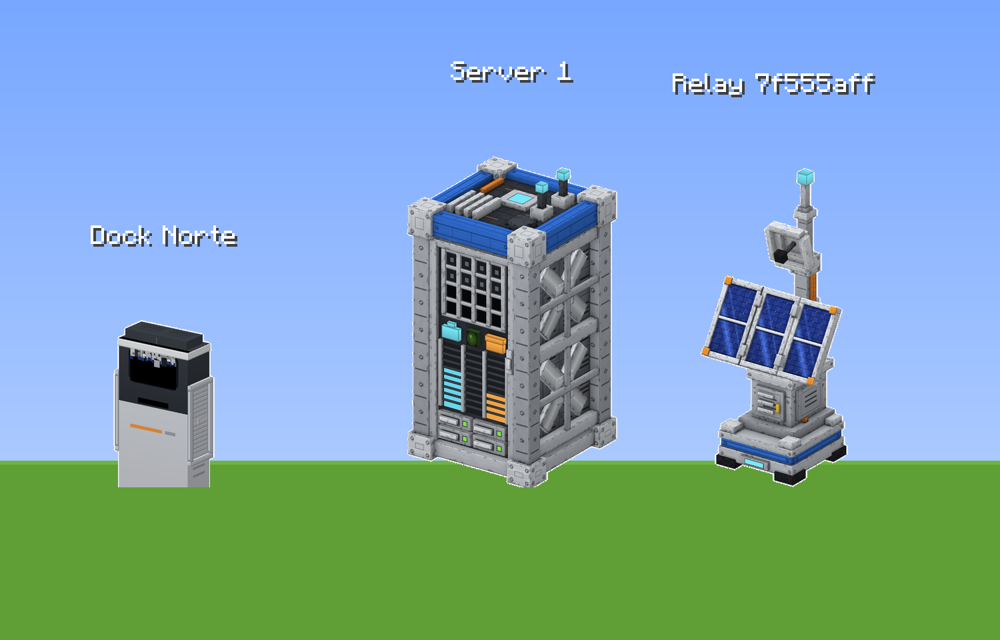
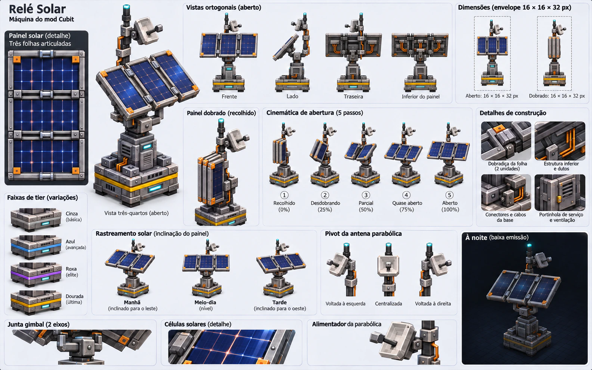
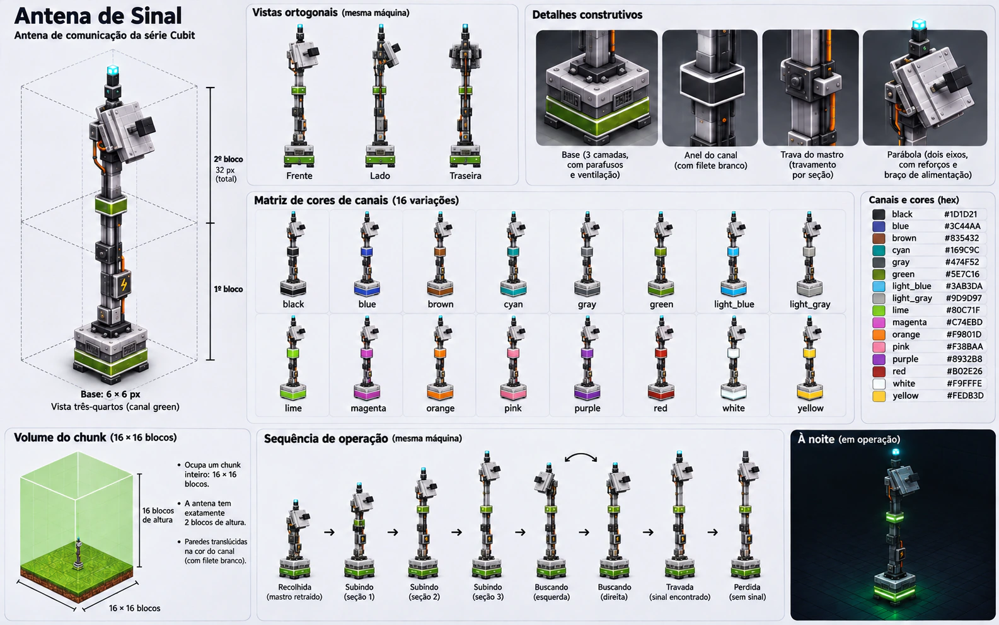

# Network

A rede sem fio do mod: o Network Server, o Solar Relay e a Signal Antenna. O conceito é do desenvolvedor e foi refinado nas perguntas 2196 a 2448, citadas só pelo número. As respostas em [`perguntas/`](../perguntas/fase-5-trabalhos.md) prevalecem. As entregas estão no [`ROADMAP.md`](../../ROADMAP.md#network-a-rede-sem-fio-em-andamento).

**Situação:** conceito autorizado (pergunta 2325). A Entrega 1, este conceito (PR #272), e a Entrega 2, a área desenhada (pergunta 2363, PR #274), já entraram na `integration/network`, a branch centralizadora, de onde sai e para onde vai toda entrega. A `develop` só recebe a feature completa (pergunta 2378). O código da Entrega 3, o Network Server e o Solar Relay, está autorizado e em andamento (pergunta 2399), e o das outras espera a autorização própria do desenvolvedor (pergunta 2224). Os números estão em [`tiers.md`](../tiers.md#network), e cada chave entra no config com o código que a lê (pergunta 2349).

## A ideia

O player põe um Network Server e um Solar Relay na base e leva antenas aos lugares de trabalho. A rede leva energia até as antenas, sem cabo, as antenas mantêm os chunks carregados e alimentam os Docks, e o XP faz o caminho inverso. O Cubit trabalha longe do player, dentro dos chunks das suas antenas. Funciona numa instância só com o mod, com redstone e sol (regra 50).

## As peças

| Peça | ID | Português | O que faz |
|---|---|---|---|
| Network Server | `cubit:network_server` | Servidor da Rede | Centro da rede: guarda FE, XP e itens e carrega o próprio chunk |
| Solar Relay | `cubit:solar_relay` | Relé Solar | Gera com o sol e é o rádio do Servidor |
| Signal Antenna | `cubit:signal_antenna` | Antena de Sinal | Carrega o chunk, recebe energia e liga Cubits, Docks e baús |
| Transceiver | `cubit:transceiver` | Transceptor | Peça compartilhada |
| Chunk Anchor | `cubit:chunk_anchor` | Âncora de Chunk | Peça compartilhada |

Servidor, Relay e antena têm Rename e o nome padrão com 8 dígitos (2275). Ao colocar um item novo de um deles, ou um Dock novo, abre a janela do nome, como a do Cubit: o nome padrão já vem no campo, e vazio, cancelar ou Esc o mantém. Recolocar não abre, porque o item guarda o ID, nem um item nomeado na bigorna (2420, 2422 e 2423). Todos só do dono, com o servidor do jogo conferindo (2259). Explosão e pistão não os afetam. Precisam de um topo sólido para ser colocados e não caem se ele sumir (2255).

## Regras da rede

1. **Um de cada por chunk, de qualquer dono:** um Servidor, um Solar Relay e uma antena. Quem chega depois é recusado, com o motivo (2271).
2. **Par:** o Servidor e o Solar Relay se pareiam sozinhos, no mesmo chunk e do mesmo dono. Sem Relay, a rede não transmite. Coberto ou sem sol, ele transmite (2268).
3. **Canais:** 16, um por antena, na ordem dos IDs em inglês: black, blue, brown, cyan, gray, green, light_blue, light_gray, lime, magenta, orange, pink, purple, red, white e yellow (2269). Abertos por tier: 4, 8, 12 e 16. O player troca o canal na tela da antena, entre os livres abertos (2309). O canal só é ocupado ao colocar a antena (2301).
4. **Dimensão:** a rede não atravessa dimensões. Um vínculo com outra é recusado, com aviso.
5. **Alcance:** qualquer distância na dimensão (2260).
6. **Quem manda:** todo vínculo e toda tela, só o dono do Servidor, da antena, do Cubit e do Dock. Os storages do chunk valem, se o player consegue abri-los (2259).

## Energia

| Número | Valor |
|---|---|
| Geração do Relay, de dia, pelo tier do Servidor | 500, 1.000, 2.000 e 4.000 FE/t (2220) |
| De noite | Só com Servidor Ultimate, 25%, 1.000 FE/t. Nada na chuva (2223) |
| Bateria do Servidor | 1,2, 4,8, 24 e 64 milhões de FE (2222) |
| Bateria do Relay e da antena | 300 mil e 600 mil FE (2289 e 2273) |
| Chunk, por tick, no Servidor e na antena | 25 FE (2216) |
| Servidor ligado, por tick e por tier, além do chunk | 20, 40, 80 e 160 FE (2435) |
| Solar Relay com par, por tick e por tier, pago pelo Servidor | 2, 5, 15 e 40 FE (2435 e 2436) |
| Antena ligada, por tick, além do chunk | 1 FE (2435) |
| Distância do Servidor à antena, por tick | 1 FE por 500 blocos completos além dos 100, também com a chave do chunk desligada (2310 e 2321) |
| Servidor, distribuindo | 20, 40, 80 e 160 mil FE/t. Cada antena, até 5.000 (2276) |
| Entrada por cabo e redstone | Servidor: 20, 40, 80 e 160 mil FE/t. Solar Relay e antena: 5.000 FE/t (2326) |

- **Ligado:** o Servidor gasta sempre que tem energia e o chunk está carregado, também com a chave do chunk desligada ou o dono offline. O chunk é pago primeiro. Zerado, ele desliga e não gasta, e o Relay do par continua gerando, para ele voltar (2439).
- **Entrada:** sol, redstone, Power Bank e cabo, em todos os três blocos (2256 e 2263). Nenhuma energia sai por cabo.
- **Caminho:** sol e Servidor, Solar Relay, antena, Dock, Cubit. O sol vai direto ao Servidor, para a energia não ir e voltar (detalhe 18).
- **Energia curta:** primeiro o gasto do chunk de cada antena, na ordem dos canais, e o resto por igual. Em cada antena, os Docks com Cubit carregando antes dos vazios (2302).
- **Dock:** a rede entra depois do sol, no limite de entrada de 5.000 FE/t (detalhe 19).

## Chunks

1. **Um chunk por antena,** o dela (2199). O Servidor carrega o dele (2264: a antena no chunk do Servidor não paga de novo).
2. **Vale sem Cubit:** a antena carrega o chunk mesmo sem Cubit ligado, se vinculada ao Servidor e com FE (2211).
3. **Chave do chunk,** em cada bloco, ligada por padrão, só do dono, e também na tela do Servidor. Desligada, tudo funciona menos o carregamento, enquanto o chunk estiver carregado por outro meio (2211, 2213 e 2214).
4. **Limites:** 48 chunks por player e 192 no mundo, no config, com 0 para sem limite. Acima disso, a antena funciona sem segurar o chunk (2215).
5. **Config do mundo:** `chunk_loading_enabled` trava a chave, com o motivo (2214).
6. **Dono offline:** os chunks saem, e os Cubits hibernam com `Owner offline`, mesmo com o chunk carregado por outro player. Volta tudo quando ele entra (2210, 2274 e 2291).

### UPS / Nobreak

A reserva de bateria do Servidor e da antena, para o próprio chunk e, no Servidor, para o gasto por ficar ligado, que conta no tempo da tela (2437). O player escolhe de 0% a 50%, de 5 em 5, e vê o tempo que ela segura. Padrão: 25% no Servidor e 50% na antena. Em 0%, avisa que o chunk pode cair (2209, 2212, 2219 e 2221). O nome é UPS em inglês e Nobreak em português (2218). Dentro da reserva, a antena segura o chunk e para de alimentar os Docks (detalhe 23). Além disso, a antena sempre guarda 5% da bateria, 30 mil FE, que nenhum Dock tira (2322).

### Queda e volta

- **Servidor zerado:** solta o chunk e volta a segurá-lo com o que paga 60 s do chunk, dele e do Relay, 56,4, 84, 144 e 270 mil FE com o par, com 30 mil como mínimo, tudo no config (2372 e 2438).
- **Elo caído:** cada peça usa a bateria e só solta o chunk quando zera, com aviso (2208). A antena sem sinal com o Servidor por mais de 20 minutos para, mesmo recarregada com redstone (2323).
- **Para o Cubit,** a rede só cai com a antena zerada, desligada ou sem sinal por mais de 20 minutos (2296 e 2323).
- **Volta:** as antenas religam uma por vez, a cada 2 s, 40 ticks, no config (2209 e 2330).
- **Quebrar a antena:** libera o canal. No mesmo chunk, tudo volta. Em outro, as ligações dela se desfazem, com aviso. O item guarda o ID, o Servidor, a bateria e o XP (2252).
- **Trocar de Servidor:** o clique em outro Servidor do dono troca a ligação e zera as dos Cubits, com aviso (2307).
- **Quebrar o Servidor:** o item guarda tier, FE, XP, itens e canais. Na mesma dimensão, em qualquer chunk, as antenas reconectam, com um Solar Relay no novo chunk (2254).

## Servidor

- **Tier:** sobe com os Modules, como o Dock. Muda bateria, tanque, canais, geração do Relay e taxas.
- **Frente:** 16 quadradinhos e três colunas de 10 traços, para bateria, XP e inventário.

| Cor | Quando (2272) |
|---|---|
| Verde | Tudo certo |
| Amarelo | Baú ou tanque de XP de Dock acima de 80%, bateria da antena ou de Cubit abaixo de 10%, ou Cubit hibernando |
| Vermelho | Todos os Cubits do canal parados, ou a antena no UPS |
| Cinza | Sem sinal com o Servidor |
| Escuro e preto | Canal livre e canal fechado |

  Vence o pior: cinza, vermelho, amarelo, verde. Cada estado tem um ícone além da cor (2277).
- **Inventário:** 27, 36, 45 e 54 slots por tier, com 128 por slot, só itens do mod. Um item sem pilha ocupa 1 por slot. Cada slot grava o item e a quantidade num formato próprio, porque o jogo só grava pilhas de 1 a 99, e sai no máximo uma pilha normal por vez (2368). Entra e sai com as regras do Dock, e as Power Banks se carregam, uma por vez, à velocidade do Dock do tier, até a reserva do UPS (2373). A Power Bank no slot de redstone descarrega (2263 e 2267).
- **XP:** tanque de 128, 256, 512 e 1.024 baldes, que entra na Entrega 7, com a coluna da frente apagada até lá (2370). Tira e envia um nível por clique, só o dono, com o total e os canos. Modos: Armazenar, o padrão, Armazenar e converter o excesso, e Converter tudo, com 9 FE por ponto (2222, 2262 e 2266). Cheio no Armazenar, o XP espera nos Docks. O que vira FE não volta a ser XP (regra 58).
- **Tela:** abas Network, Energy, XP, Storage e Log (2277). O Log guarda 100 eventos, no config (2278). Uma antena sem sinal ou descarregada aparece apagada, com a última foto e a hora do jogo (2332).

## Solar Relay

Gera, transmite e guarda 300 mil FE e 32 baldes do que vai e vem (2289). O painel abre com o sol e o acompanha (2338). Segue o tier do Servidor, sem Module próprio (2217). Sem par, a faixa fica cinza, o painel, guardado, e ele não gera, com o motivo na tela e a bateria mantida (2374). Tela: geração de agora e máxima, motivo se parado, bateria, par e o slot de redstone (2280).

## Ver o chunk

O botão `View`, na linha `Load the chunk`, mostra a parede em volta do chunk do Servidor: translúcida, ciano, de 1 px, do bloco de apoio até 16 blocos acima, até 128 blocos do player. Só o dono vê, com o Tablet na mão, em qualquer app até o app Network existir. Desligada por padrão, salva no Servidor e no item (2443 e 2446 a 2448). Ao passar o mouse, o botão diz `Shows the chunk with the Tablet in hand`, em português `Mostra o chunk com o Tablet na mão` (2512).

## Nomes flutuantes

Com o Tablet na mão, em qualquer app, o nome de cada Dock, Servidor e Solar Relay do player aparece sobre o bloco, a até 32 blocos. Na entrega 5, passa a valer só com o app Network, que soma a antena (2421, 2424, 2425 e 2469).

1. **Texto:** só o nome, no branco da fonte do jogo, com a sombra dela, sem fundo e sem borda (2518 e 2519). A cor do tier e a do canal da antena não aparecem no nome.
2. **Lugar:** a 0,5 bloco acima do topo do bloco, sempre de frente para o player (2514).
3. **Distância:** tamanho fixo no mundo, como a placa de nome do jogo, então encolhe de longe (2515).
4. **Atrás de blocos:** aparece através deles, mais fraca, a 32%, e forte na frente (2425).
5. **Tela aberta:** com qualquer tela aberta, nenhum nome aparece. Voltam ao fechá-la (2516).
6. **Só do dono:** um player nunca vê os nomes dos blocos de outro.

Detalhes propostos pelo agente:

1. **O nome no cliente:** o Dock, o Servidor e o Relay mandam o nome ao cliente junto do dono, só no pacote de atualização: o save não muda.
2. **Busca:** a cada 10 ticks, o cliente procura esses blocos nos chunks já carregados a até 32 blocos, sem ler bloco a cada quadro (regra 21).
3. **Dock com o painel:** o topo é o do bloco de cima do Dock, aberto ou não, para a caixinha não pular quando o painel se transforma.
4. **F1:** com a interface escondida, os nomes somem, como a mira e a barra de itens.

## Antena

- **Única:** sem tier e sem upgrade (2199). 600 mil FE e 64 baldes, com a faixa da base em cinza (2273).
- **Ligar:** com o clique no Servidor, a antena fica ligada a ele, também numa pilha, até 16. Com os canais cheios, colocar é recusado, com o motivo (2301 e 2307). Não precisa de céu (2306).
- **Tela:** nome, canal, sinal, bateria, XP, slot de redstone, UPS, o que está ligado, na linha `Links`, com os Cubits carregados ligados a ela e os Docks que ela alimenta, contados uma vez por segundo com a tela aberta, só os Cubits carregados, e três chaves: a geral, a do chunk e a da parede (2280, 2297, 2593 e 2605). A geral, desligada, para tudo, e os Cubits hibernam.
- **Cor:** faixa inferior e anel na cor do canal, com um fio em volta, escuro nas cores claras e branco nas escuras, e o preto mais opaco (2270 e 2343).
- **Parede:** translúcida, de 1 px, na cor do canal, do bloco de apoio até 16 blocos acima, em volta do chunk. Só o dono vê, com o Tablet na mão e o app Network. Desligada por padrão, e várias podem ficar ligadas ao mesmo tempo (2225 e 2238). A altura é só ilustrativa (2241).

## App Network

Clique na antena, depois no Cubit, que fica ligado, e depois em cada Dock e baú, marcados para aquele Cubit. O Dock marcado já se liga à antena. Antena e Dock, sem Cubit, só liga a energia. Repetir o clique desfaz, e setas mostram tudo (2249). Os baús marcados fazem parte da rede (2249). Com o app selecionado, o nome do Dock, do Servidor, do Solar Relay e da antena do player aparece sobre cada um, a até 32 blocos, de frente para ele e mais fraco atrás dos blocos (2421, 2424 e 2425), só com o texto branco e a sombra (2518 e 2519). Até esta entrega, os nomes aparecem com o Tablet na mão, em qualquer app, como em [Nomes flutuantes](#nomes-flutuantes) (2469).

| Por Cubit | Base | Advanced | Elite | Ultimate |
|---|---|---|---|---|
| Antenas | 0 | 1 | 4 | 9 (2226) |
| Baús | 1 | 2 | 4 | 6 (2232) |
| Docks | 1 | 2 | 4 | 6 (2233) |
| Baús do Organizador | — | 12 | 18 | 25 (2235) |

- **Só os dele:** na área, o Cubit só usa os Docks e baús marcados para ele, a qualquer distância nos chunks das antenas dele, sem atravessar nem pular nada. Sem caminho, desiste, avisa e tenta outro (2233 e 2250). O Call do Dock e o Ir para o Dock valem só para os marcados (2303).
- **Compartilhar:** um baú ou Dock pode servir a vários Cubits (2229). Qualquer storage do jogo ou de mods serve.
- **Vizinhos:** as antenas de um Cubit são do mesmo Servidor e ficam em chunks que dividem um lado, sem vazio entre eles (2257 e 2258).
- **Desligar uma antena:** o segundo clique em 5 s confirma. Se o desenho passava por ali, a área inteira some, e os Docks e baús daquele chunk saem do Cubit (2299 e 2300).

## Área

Muda o app Área (2225, 2240 e 2243 a 2246, 2287 e 2311).

1. O player escolhe o Cubit e clica em cada ponto, a até 32 blocos. A linha, de 3 px, fica vermelha e liga os pontos em ângulo reto. De 4 a 32 pontos. O clique em outro Cubit do player descarta o desenho e recomeça com ele, e um Cubit Base ou de outro player só avisa (2357).
2. Clicar no primeiro ponto fecha a forma, e a linha fica verde. Shift + clique aplica. Com a linha vermelha, Shift + clique desfaz o último ponto, também mirando num Cubit (2352). Com a verde, o clique num ponto só tira o fechamento, e os pontos ficam (2355). Trocar de app cancela.
3. Um ponto ou linha fora dos chunks das antenas é recusado na hora, com o motivo. Também a linha que passa por um bloco que já é do desenho, fora a emenda e o fechamento, e o ponto que passa do tamanho ou da altura do tier (2354 e 2356). Linhas lado a lado valem.
4. Os blocos dos pontos e das linhas fazem parte da área. A altura vai do ponto mais baixo ao mais alto, até 8, 24 e 32 por tier.
5. **Ver:** com o Cubit escolhido e o app Área, a linha aparece, verde e sem cubos (2360).
6. **Apagar:** Shift + clique no Cubit, sem desenho em andamento, com confirmação (2299 e 2352). Quem fica sem área para e desliga, com a carga mantida, e, no Dock, continua no Dock. Os itens, o card e as chaves não mudam (2353).
7. **Caminho:** entre dois lugares da área, contorna o canto por dentro e só passa por fora sem outro caminho. A trava total vem na entrega 6 (2365).
8. **Linha:** uma barra de 3 px do bloco, com volume, no centro do bloco, e um cubo de 6 px em cada ponto enquanto a área não é aplicada. O trecho até a mira é translúcido e só aparece em ângulo reto, com o bloco na mira marcado (2358). Desenhando, é um traço só, que sobe na vertical. Fechada ou aplicada, mostra o contorno da base e o do topo, ou um só com um nível (2359). Atrás de um bloco, fica mais fraca (2361).
9. **Até a rede ser obrigatória,** na entrega 6: o desenho cabe nos limites de hoje, 16, 32 e 64 blocos, e 64 e 128 no Patrulheiro, conferidos em cada clique. O centro do retângulo em volta dele fica no raio de chamada do Dock, na dimensão do Cubit, o que é conferido ao aplicar (2350, 2351 e 2356). Na entrega 5, o Cubit com ao menos uma antena só desenha dentro dos chunks delas, e a área cujo interior cobre um chunk sem antena não fecha nem é aplicada (2586 e 2601).

O Cubit espera a área ser desenhada, parado e acordado, com `Waiting for area` (2239 e 2298). As áreas antigas, em caixa, são apagadas (2283).

## O Cubit na rede

- **Regra:** todo o modo área, com ou sem card, só com a rede (2202 e 2206). Seguir, defender, coletar e escoltar, livres (2237 e 2253).
- **Nunca sai dos chunks ativos,** nem na fuga (2201 e detalhe 2).
- **Sem rede:** hiberna com `No network`, avisa uma vez e volta sozinho (2207). Também ao perder a última antena, guardando a área e as marcas (2298).
- **`Follow`:** pausa, e o `Back to work`, na tela dele e no Tablet, o manda de volta, na mesma dimensão e com o chunk carregado (2251 e 2308).
- **Recolher e morrer:** apagam antenas, área, Docks e baús (2251 e 2304). Ao morrer, o dono é avisado.
- **Patrulheiro:** segue as mesmas antenas, e persegue até 16 blocos para fora, só com o dono por perto e em chunk que roda entidades (2231).
- **Organizador e Cozinheiro:** a partir do Advanced. Organizador: 4 máquinas ou destinos no Advanced. Cozinheiro: 2, 4 e 8 fornos. Os dois: 50 FE por pilha, 20 e 160 ticks no Advanced (2235, 2236 e 2242). O Organizador marca 4 baús no Advanced até a Entrega 5 (2364). Tudo nos chunks das antenas.

## XP

O Dock ganha dois modos: enviar o excesso e enviar tudo ao Servidor (2261). O XP sobe pela antena e pelo Solar Relay, a 200, 400, 700 e 1.000 mB/t por antena, pelo tier do Servidor (2276 e 2327). O que os Docks passam além disso espera neles. Com a rede fora ou o Servidor cheio, espera no Dock, e, com ele também cheio, age como Armazenar e converter o excesso, que continua o padrão (2265).

## Avisos e telas

- **Barra de ação, uma vez:** antena no UPS, antena zerada, Cubit hibernado por falta de rede, Cubit morto na rede e Servidor cheio de XP (2279).
- **Aba Network** na tela do Cubit e no Tablet, entre Work e XP: antenas, com a cor do canal, Docks e baús usados, motivo e `Back to work` (2315 a 2317).
- **Estados do Cubit:** `Hibernating · No network` e `Hibernating · Owner offline` em azul, e `Waiting for area` em roxo (2331).
- **App Network:** rosa (2328).
- **Jade,** curto: nome, canal, sinal, bateria e chave do chunk (2285).
- **Operador:** `/cubit network list` e `release` (2286).
- **Sons:** 14, em [Sons](#sons) (2339).

## Receitas

Na Engineering Desk, sem bloqueio por progressão, na categoria `Dock and Network`. Transceptor e Âncora em Shared parts (2282, 2305 e 2419).

| Item | Materiais |
|---|---|
| Transceiver | 1 Circuit Board, 1 pérola do ender, 2 cobres e 1 redstone |
| Chunk Anchor | 3 pérolas do ender, 3 obsidianas, 2 ouros e 1 diamante |
| Network Server | Bloco de ferro, HD, XP Tank, Base Power Cell, Neural Core, Chunk Anchor, Transceiver e Display Panel |
| Signal Antenna | Para-raios, Transceiver, Chunk Anchor, Induction Coil, Base Power Cell e XP Tank |
| Solar Relay | Solar Panel, Transceiver, Base Power Cell e XP Tank |

## Visual

Do rascunho do desenvolvedor, com as pranchas aceitas como referência na pergunta 2341. O que a lista diz prevalece sobre a imagem, e as correções entram direto no modelo:

- **Servidor:** 2 blocos de altura, com 29 px de corpo e 3 px das antenas do topo, que fazem o enlace com o Relay. Faixa do tier no alto e na borda do topo, cinza, azul, roxa e dourada, e o Ultimate em netherite. Na frente, os 16 quadradinhos, a pilha ciano, o orbe verde e o baú laranja, com 10 traços cada, de 10% (2329). Um LED fica ciano com o par formado.
- **Solar Relay:** 2 blocos de altura, com a base, a faixa do tier do Servidor, o painel inclinado, o mastro com a parabólica e a antena vertical com LED.
- **Antena:** 2 blocos de altura, base de 6×6 px, mastro, parabólica e antena vertical com LED. A faixa inferior e o anel, a cerca de 1,4 bloco, logo abaixo da parabólica, na cor do canal, e a outra faixa em cinza (2273 e 2342). A parabólica é um prato côncavo, em degraus (2341).
- **Correções das pranchas (2341 e 2344):** a base do Relay tem 9 a 10 px, para o painel aberto caber em 16. O Servidor tem 4 HDs, 2 antenas e 2 ventoinhas por lado, as lâmpadas acesas mostram a forma do estado, e o Ultimate se distingue em netherite.
- **Cor do metal (2388):** alumínio claro no Servidor e no Relay, perto do cinza do Dock, no lugar do grafite das pranchas, com o desgaste em marcas mais escuras. O fundo das lâmpadas continua escuro, e o Ultimate, em netherite escuro.
- **Luzes:** textura acesa, sem luz real (2281).

### Construção

**Crítico (2336):** nenhum bloco quadrado com textura chapada. Os modelos têm profundidade, relevo, cor, sombreamento e realismo, acima do Dock de hoje (2337):

| Meta | Network Server | Solar Relay | Signal Antenna |
|---|---|---|---|
| Cubos do modelo | 90 a 120 | 60 a 90 | 60 a 90 |
| Textura | 1024×1024 | 1024×1024 | 1024×1024 |

- **Relevo:** de 0,5 a 2 px, na geometria e não só pintado: grades, painéis recuados, parafusos, cabos, dobradiças e bordas.
- **Faces:** nenhuma maior que 6×6 px sem relevo.
- **Textura:** sombra nas juntas, brilho nas quinas, desgaste leve e materiais distintos, como metal escovado, plástico, vidro e borracha. Camada acesa para o que emite luz.
- **Conferência:** prévia de todos os lados e em todos os estados, ao lado do Dock e da mesa, antes do teste no jogo.

### Animações

No GeckoLib, por estado, com o servidor decidindo o estado (2338). Parado, quase nada se move. As ventoinhas giram só com FE entrando ou carregando Power Bank, e o Relay transmite enquanto o sol vai ao Servidor e, da Entrega 5 em diante, também às antenas, cada um com o seu loop de som (2375):

- **Tempos (2391):** partida do Servidor em 3 s, queda em 1,5 s, e o painel do Relay abrindo em 4 s e fechando em 4 s.
- **Network Server:** tranca e partida ao ligar, ventoinhas atrás da grade, HDs piscando, barras que sobem e descem, e queda de luz ao perder a energia.
- **Solar Relay:** o painel se desdobra em etapas, acompanha o sol e se guarda, e a parabólica se orienta ao transmitir.
- **Signal Antenna:** o mastro se ergue ao ser colocada, e a parabólica procura e trava o sinal, e o perde.

### Sons

Por prompt, aceitos antes do código, baixos e com alcance curto. Os loops tocam só por perto (2339):

| Bloco | Sons |
|---|---|
| Network Server | Partida, loop de ventoinha, queda, upgrade e aviso de UPS |
| Solar Relay | Painel abrindo, painel fechando, trava e loop de transmissão |
| Signal Antenna | Erguer, travar o sinal, perder o sinal, sinal de volta e ligar ao Servidor |

## Detalhes completados pelo agente

Não foram perguntados um a um e foram autorizados em bloco com o conceito, sem veto (2248 e 2325).

1. **Caminho longo:** andar por trechos até o Dock e o baú, com a rota refeita no caminho, e desistir só sem progresso, como hoje.
2. **Borda:** toda ação confere se o destino está num chunk ativo. Um Cubit empurrado para fora volta no mesmo tick.
3. **Hibernar sem rede:** vale com e sem card. Primeiro o inventário cheio, depois a falta de rede, e a rede volta a acordá-lo sozinha.
4. **Guardar:** a rede nos dados do mundo, por dono, com os blocos e os tickets conferidos ao abrir. Um dado quebrado é ignorado, com log (regra 17).
5. **Passar FE e XP:** só com as duas pontas carregadas, em intervalo, na mesma chamada, com teste da soma antes e depois (regra 13).
6. **Voltar:** as antenas religam uma por vez, com intervalo, para não travar.
7. **Parede e linhas:** só no cliente, do dono, sem bloco de luz.
8. **Desempenho:** nenhuma varredura por tick. A máscara da área é calculada uma vez, ao aplicar.
9. **Proteção:** explosão e pistão não afetam os blocos, e o operador remove os abandonados, como no Dock.
10. **Item:** Servidor, Solar Relay e antena guardam o estado no item e não se empilham com estado.
11. **Saves:** chaves novas e opcionais, com a lista no contrato.
12. **Testes:** uma rede pronta de teste para as GameTests de área, feita antes da regra nova.
13. **Tablet:** a lista, a foto do Cubit e a aba Recursos passam a mostrar o estado sem rede e o tamanho da área desenhada.
14. **Jade e JEI:** opcionais, como hoje, e a rede abre sem eles.
15. **Textos:** em inglês e em português, com as mesmas chaves.
16. **Área em L:** as regras de borda do Patrulheiro, da ronda e da volta à área passam a usar a forma desenhada.
17. **Colisão:** base de 6×6 e mastro com caixa pequena, para não travar o caminho do Cubit.
18. **Solar Relay:** o sol vai direto ao Servidor, e a bateria dele só guarda o que vai às antenas, para a energia não ir e voltar.
19. **Dock:** a energia da rede entra depois do sol e dentro do limite de entrada do Dock, de 5.000 FE/t.
20. **Cubits:** nenhum limite por antena. O "até 3 por área" de `tiers.md` não existe no código, e sai.
21. **Itens dentro de itens:** o Servidor com estado não cabe em outro inventário do mod nem num shulker, como a Engineering Desk com itens.
22. **Marcas quebradas:** Dock e baú marcados valem pela posição. Quebrados, são pulados, e voltam a valer se recolocados no mesmo lugar.
23. **UPS:** dentro da reserva, a antena só segura o chunk, e os Docks param de receber. Os Cubits seguem com a própria bateria e com o estoque dos Docks (2296). Com a chave do chunk desligada, o UPS aparece desligado.
24. **Retorno do dono:** ao entrar, as antenas religam uma por vez, como depois de zerar (detalhe 6).
25. **Abas:** a aba Network entra na tela do Cubit e no Tablet, com a altura conferida em prévia (2316 e 2317).

## Detalhes da Entrega 3

Propostos pelo agente, conferidos contra o código e autorizados em bloco, sem veto (pergunta 2376). O código da entrega espera a autorização própria (pergunta 2224).

1. **Um por chunk:** ao colocar, o chunk é conferido pelos blocos dele, já carregado. Se um comando puser dois, só o primeiro, o de menor posição, forma o par e segura o chunk.
2. **Par:** refeito ao colocar, quebrar e carregar, e nunca por varredura a cada tick.
3. **Quebrar:** só o dono, um operador ou um player no criativo, como no Dock.
4. **Módulos:** só no Servidor. Um Module no Relay fica na mão, com o aviso de que ele segue o tier do Servidor.
5. **Mãos e automação:** o clique guarda a Power Bank, a Toolbox e o Damaged Cubit, e a redstone vai ao slot de energia. O funil segue as regras do Dock, com até 128 por slot.
6. **Tirar do slot:** clique, metade, tecla de atalho, soltar e Shift + clique levam no máximo uma pilha normal.
7. **Quantidade quebrada:** acima de 128 ou de um item que não cabe, o resto cai ao lado do bloco, com log (regra 17).
8. **Relay por cabo e redstone:** enche só a própria bateria, que espera as antenas da Entrega 5. O sol nunca passa por ela.
9. **Céu:** o Relay lê o céu acima do segundo bloco, no intervalo do Dock. O painel abre com 3 s de sol e fecha com 3 s sem ele, pela chave do Dock, `dock_solar_deploy_delay_ticks` (2412), também na chuva, e fica aberto à noite só com o Servidor Ultimate.
10. **Acompanhar o sol:** de leste a oeste do mundo, não importa para onde o bloco olha, até 11° para cada lado, o que cabe no bloco (2384). Virado para norte ou sul, o painel fica inclinado para a frente e gira de lado. Para leste ou oeste, fica quase deitado e vai de 79° a 101° no eixo da frente (2385). Só inclina depois de desdobrar. Com a lua, fica nivelado.
11. **Frente:** cada traço é 10%, com ao menos um aceso acima de zero. A coluna do inventário mede os slots ocupados. Os quadradinhos abertos pelo tier ficam como canal livre, e os outros, fechados. Sem energia, tudo apaga.
12. **Ligado e caído:** a partida toca quando a bateria sai de zero, e a queda, quando zera. Ao carregar o mundo, nenhuma das duas toca.
13. **UPS:** o aviso soa uma vez ao descer para a reserva e volta a valer ao sair dela. Em 0%, não soa. O tempo na tela é o da porcentagem escolhida.
14. **Limite de chunks:** acima dele, o Servidor funciona sem segurar o chunk, e a tela diz o motivo. Vale quem chegou primeiro.
15. **Dono offline:** o chunk sai. Se outro player o mantém carregado, o Servidor continua gerando e carregando, sem pagar os 25 FE/t. Quando o dono entra, os chunks dele voltam um a cada 2 s, com o primeiro na hora (2413).
16. **Estado no item:** o Servidor com itens ou energia não cabe num shulker nem num inventário do mod. Vazio, cabe.
17. **Abas:** Energy e Storage, na ordem da 2277, com os lugares das outras livres. O ícone de Storage é o do Dock, e o de Energy é novo. O Rename e o dono ficam na aba Energy até a aba Network existir, o tier do Relay aparece na linha do par, na tela dele, e a quantidade de 3 dígitos sai em letra menor (2397).
18. **Receitas:** as duas peças em grade, como as outras peças, e os dois blocos sem forma, como o Dock.
19. **Config:** `chunk_resume_energy`, em `[network]`, com 30.000, e a `wake_interval_ticks`, que vem da Entrega 4 (2413). As outras chaves já estão em [`tiers.md`](../tiers.md#network) e entram com o código que as lê.
20. **Saves:** nada do Dock muda. O formato do slot é uma lista com `Slot`, o item com 1 e `Amount`.

## Detalhes da Entrega 4

Decididos nas perguntas 2542 a 2553. O código da entrega espera a autorização própria (pergunta 2224).

1. **Parede da antena:** com o Tablet na mão, em qualquer app, na cor do canal, como a do Servidor. A entrega 5 troca para o app Network (2542).
2. **Nomes flutuantes:** a antena entra agora, como o Dock, o Servidor e o Relay (2543).
3. **Chave geral no Servidor:** entra com a aba Network do Servidor. Na entrega 4, fica só na tela da antena (2544).
4. **Aba Energy do Servidor:** a linha `Antennas −X FE/t`, com o que saiu para elas no tick, e, ao passar o mouse, quantas recebem e quantas estão sem energia ou sem sinal (2545).
5. **Sem ligação:** colocar uma antena que não foi ligada a um Servidor é recusado, com `Link it to a Server first` (2546).
6. **Canal ao recolocar:** volta ao último, se livre, ou pega o primeiro livre, com aviso (2547).
7. **Tela da antena:** nome, canal, sinal, bateria, redstone, UPS, as três chaves e o Servidor ligado. O XP e as ligações entram nas entregas 7 e 5, nos lugares reservados (2548).
8. **Transmissão do Relay:** a parabólica e o loop de transmissão do Relay valem já na entrega 4, enquanto ele manda FE a uma antena (2549).
9. **Reserva do Servidor:** ele só manda às antenas o que passa do próprio UPS (2550).
10. **Entrada da antena:** a rede e o cabo somam 5.000 FE/t, o cabo primeiro (2551).
11. **Sinal:** o Servidor dela na mesma dimensão, num chunk carregado, com energia e com o Relay do par. Sem algum deles, `No signal`, e os 20 minutos começam a contar (2552).
12. **Volta do sinal:** a antena parada solta o chunk e não gasta nada, e religa sozinha quando o sinal volta, na fila de uma a cada 2 s, com o som do sinal de volta (2553).

Propostos pelo agente:

13. **Ligar:** o clique com o item, ou com a pilha, num Servidor do dono liga, com o som de ligar e `Linked to {Servidor}` na barra de ação. Num Servidor de outro dono, nada acontece, com o motivo.
14. **Recusas ao colocar:** sem ligação, canais cheios, outra dimensão ou já uma antena no chunk, sempre com o motivo na barra de ação e o item na mão.
15. **Sinal na tela e no Jade:** `Linked`, `No signal · stops in N min` e `Stopped · no signal`, com a prévia da tela antes do código.
16. **Repartir:** a cada tick, o Servidor manda pelo Relay só às antenas com sinal, primeiro o gasto do chunk de cada uma, na ordem dos canais, e o resto por igual (2302), no limite do tier (2276), antes das Power Banks do storage (2571).
17. **Fila de volta:** os chunks dos Servidores e das antenas do mesmo dono voltam na mesma fila, pela `wake_interval_ticks` (2413).
18. **Comando:** `/cubit network list` lista os Servidores e as antenas que seguram chunk, por player, e `release` solta todos ou os de um player, só para operador (2286). O `release` também desliga a chave `Load the chunk` de cada bloco solto, na hora, se ele está carregado, ou quando carregar, por uma marca na lista `Released` do `cubit_network`, para ele não pedir o chunk de volta (2578).
19. **Saves:** o `cubit_network` ganha a lista `Servers`, com `Id`, `Owner`, `Dimension`, `Pos` e `Tier`, para achar o Servidor e os canais dele de longe, e a lista `Antennas`, com `Owner`, `Dimension`, `Pos`, `Server` e `Channel`. O item da antena guarda `cubit:network_id` e, no `cubit:network_state`, a bateria, o UPS e os campos `server`, `server_name` e `channel`: o Servidor, o nome dele no clique e o último canal (2566 e 2567). Chaves novas e opcionais.
20. **GameTests:** ligar, recusar, canais e a recolocação, a soma de FE entre o Servidor e as antenas, a reserva, o sinal e os 20 minutos, a volta, os limites, o dono offline e o comando.
21. **Outro dono:** a antena ligada a um Servidor de outro player é recusada ao colocar, com `This Server belongs to another player` (2569).
22. **Chunk da antena:** no chunk que o Servidor dela segura, ela não segura de novo e mostra `Held by its Server`. Parada sem sinal, ela solta o chunk, mas fica esperando na fila, e o Servidor, com energia e com o Relay, a chama de volta, uma a cada 2 s (2264 e 2553).

## Detalhes da Entrega 5

Decididos nas perguntas 2585 a 2593. O código da entrega espera a autorização própria (pergunta 2224).

1. **Marcados:** os Docks e baús marcados para um Cubit ficam nele e aparecem nas setas, e o Dock marcado já recebe energia da antena. O Cubit usar só os marcados entra na entrega 6, com a regra obrigatória. Até lá, a descarga e as marcas de hoje continuam (2585).
2. **Área:** um Cubit com ao menos uma antena só desenha dentro dos chunks delas, com o ponto ou a linha de fora recusados na hora, e os limites de tamanho e altura de hoje continuam. Sem antena, desenha como hoje até a entrega 6 (2586).
3. **Reserva da antena:** ela só dá aos Docks o que passa do próprio UPS, como o Servidor com as antenas (2550), e nunca abaixo do piso de 5% (detalhe 19, 2587 e 2599).
4. **Cliques:** pelo Cubit escolhido no Tablet. Clicar num Cubit do dono o escolhe, clicar numa antena a liga ou desliga daquele Cubit, e clicar num Dock ou baú o marca ou desmarca para ele. Cada Dock recebe energia da antena do chunk dele. Sem Cubit escolhido, clicar na antena e depois num Dock só liga a energia (2588).
5. **Energia do Dock:** a antena guarda os Docks que alimenta, na chave nova `Docks`. Marcar um Dock para um Cubit também o liga à energia, e desmarcá-lo do Cubit mantém a energia. Só o clique na antena e no Dock, sem Cubit escolhido, desliga a energia, com confirmação se algum Cubit ainda usa o Dock (2589).
6. **Antena do meio:** desligar uma antena que separaria as outras do Cubit em dois grupos é recusado, com o motivo. As das pontas saem com a confirmação de 5 s (2590).
7. **Ícone:** o app Network não tem ícone, como os outros: só a faixa e o nome em rosa (2591).
8. **Setas:** sobre cada antena do Cubit, na cor do canal; sobre cada Dock marcado, no vermelho do app Dock; sobre cada baú, no laranja do app Descarga; e sobre os Docks só com energia da antena clicada, em cinza, com prévia antes do código (2592).
9. **Telas:** a linha `Links` na tela da antena, com quantos Cubits e Docks ela alimenta, e a linha `Network` na aba do Dock, com o que entrou pela rede no tick, com prévia antes do código (2593).

Propostos pelo agente:

10. **Recusas no clique:** um Dock ou baú fora dos chunks das antenas do Cubit; uma antena de outro dono, de outro Servidor que não o das outras antenas do Cubit ou fora da vizinhança pelo lado; e qualquer marca além do limite do tier, sempre com o motivo e o número do limite na barra de ação.
11. **Baú:** qualquer bloco com a capability de itens do NeoForge, do jogo ou de mods, que o player consegue abrir (2259).
12. **Energia:** a cada tick, depois do próprio gasto, a antena manda aos Docks dela só o que passa do UPS, primeiro aos com Cubit carregando e depois por igual, cada um até o que ainda cabe na entrada de 5.000 FE/t, depois do sol (detalhe 19). Ela perde exatamente o que os Docks guardam. Desligada, não manda nada.
13. **Antena quebrada:** as ligações ficam no Cubit e na lista dela. Recolocada no mesmo lugar, tudo volta, e a regra de perder a última antena fica para a entrega 6 (2298).
14. **Recolher e morrer:** apagam as antenas, os Docks e os baús do Cubit (2251 e 2304).
15. **Nomes e parede:** os nomes flutuantes e a parede passam a aparecer só com o app Network (2425 e 2542).
16. **Saves:** o Cubit guarda `NetworkAntennas`, `NetworkDocks` e `NetworkChests`, cada um com `Dimension` e `Pos`, e a antena, `Docks`, com `Pos`. Chaves novas e opcionais.
17. **Rede de teste:** um cenário das GameTests com o Servidor, o Relay, as antenas, o Cubit e os Docks prontos, usado por todas as de área daqui em diante.
18. **GameTests:** ligações, recusas, vizinhança, a antena do meio, a energia curta, a soma de FE e a reserva.

Decididos nas perguntas 2599 a 2602, depois da autorização do código:

19. **Piso da antena:** ela dá aos Docks só o que passa do maior entre o UPS e os 5% da 2322 (`antenna_floor_percent`). Com UPS 0%, desce até 5%, sem zerar. Muda o detalhe 3 e a 2587 (2599).
20. **Desligar uma antena:** os Docks e baús do chunk dela sempre saem do Cubit, e a energia do Dock continua (2589). Toda antena pede o segundo clique em 5 s, e a área some se passava por ali (2600).
21. **Interior da área:** o clique que fecharia uma forma cujo interior cobre um chunk sem antena do Cubit é recusado, com o motivo, e o desenho continua aberto (2601).
22. **Baús do Organizador:** no app Network, o Cubit com o card do Organizador marca até `network_organizer_chests` (12, 18 e 25), e os outros, até `network_chests`. As marcas do app Marcar seguem com 4, 9 e 18 até a entrega 6. Se o card sair, ficam os primeiros baús, até o limite (2602).
23. **Docks no item da antena:** o item guarda a lista `Docks` no campo `docks` do `cubit:network_state`. Recolocada no mesmo chunk, ela volta, e, em outro, é descartada (2603).
24. **Cortar a energia de um Dock:** pela antena e pelo Dock, sem Cubit, sempre pede o segundo clique em 5 s, dizendo quantos Cubits carregados usam o Dock (2604).
25. **Nome e cor do app:** `Network` em inglês e `Rede` em português, como a linha da aba do Dock, e a faixa no rosa `#EE6FB5`.

## Contrato

Os nomes foram propostos pelo agente, a partir do padrão do mod, e autorizados (2334). Entram no código com cada entrega. Os números estão em [`tiers.md`](../tiers.md#network).

| Onde | Nome | Conteúdo |
|---|---|---|
| Blocos e itens | `cubit:network_server`, `cubit:solar_relay`, `cubit:signal_antenna`, `cubit:transceiver` e `cubit:chunk_anchor` | Cada um com a receita de mesmo ID |
| Dados do mundo | `cubit_network` | Servidores, antenas, canais, vínculos, a última foto e o Log, por dono. Na Entrega 3, só a lista `Chunks`, com `Owner`, `Dimension`, `Pos` e `Waiting` (2413). Na Entrega 4, as listas `Servers`, com `Id`, `Owner`, `Dimension`, `Pos` e `Tier`, `Antennas`, com `Owner`, `Dimension`, `Pos`, `Server` e `Channel`, e `Released`, com `Dimension` e `Pos`, dos blocos soltos pelo operador enquanto descarregados (2578) |
| Ticket | `cubit:network` | Os chunks, conferidos ao abrir o mundo |
| NBT dos blocos | `NetworkId`, `Owner`, `CustomName`, `Energy`, `XpTank`, `Slot`, `Ups` e `ChunkLoading` | Comuns aos três, com o `Tier`, os `Items`, o `Drained` e o `ShowWall` no Servidor e o `SolarPanel` no Relay (2410 e 2448) |
| NBT da antena | `Server`, `ServerName`, `Channel`, `NoSignalTicks`, `ChunkLoading`, `Drained`, `Enabled`, `ShowWall`, `Ups` e `Docks` | O Servidor, o nome dele no clique, o canal, o tempo sem sinal, a chave e a carga do chunk, como no Servidor, as outras chaves e, na entrega 5, os Docks que ela alimenta (2589) |
| Item | `cubit:network_id` e `cubit:network_state` | O ID e o estado guardado, como o do Dock: `tier`, `energy`, `items` (`slot`, `item` e `amount`), `ups`, `chunk_loading` e `show_wall`. O Relay grava só `energy` (2410, 2411 e 2448), e a antena grava `energy`, `ups`, `chunk_loading`, `show_wall`, `server`, `server_name`, `channel` e, na entrega 5, `docks` (2566, 2567 e 2603). A chave geral da antena não vai ao item, e ela volta ligada |
| NBT do Cubit | `NetworkAntennas`, `NetworkDocks`, `NetworkChests`, `NetworkPaused` e `DrawnArea` | `DrawnArea` tem os pontos, a altura e a dimensão. A chave antiga `WorkArea` é ignorada (2283) |
| NBT do Cubit | `HibernationReason`: `no_network` e `owner_offline` | Os motivos novos |
| Modos do Dock | `XpMode`: `send_excess` e `send_all` | Os dois modos novos |
| Modos do Servidor | `XpMode`: `store`, `store_convert_excess` e `convert_all` | O padrão é `store` |
| Config | `[network]`, `[network.{tier}]` e `network_*` em `[general_robot.{tier}]` | As chaves de [`tiers.md`](../tiers.md#network) |
| NBT de `DrawnArea` | `Points`, `Low`, `High` e `Dimension` | Os cantos da forma, as alturas e a dimensão. Já no código, com a Entrega 2 |
| Config, que saem | `area_size_blocks` e `patroller_area_size` | Na entrega 6 (2350). O tamanho vem das antenas (2226). O `unload_chests` fica só para quem segue (2284) |
| Tablet | App `network` | O valor no componente do item |
| Comando | `/cubit network list` e `/cubit network release` | Só operador |
| Receitas | `desk_category`: `dock` e `parts` | Sem categoria nova no JSON (2305) |

Os saves de antes da Network continuam abrindo: perde-se a área de cada Cubit (2283 e 2189). O config das instâncias de teste é apagado uma vez (2324).

## Fora do escopo

Compartilhar a rede com outros players, rede entre dimensões, itens viajando pela rede, que ficam com o robô de transporte (2197) e o storage wireless (#207), e integração com mods de proteção de terreno.

## Histórico de modificações

| Pessoa | Data e hora | Modificação |
|---|---|---|
| Zennd | 2026-11-26 09:52 | Detalha a linha `Links` da tela da antena. |
| Zennd | 2026-11-26 09:41 | Diz que a área já fica nos chunks das antenas na entrega 5. |
| Zennd | 2026-11-26 09:25 | Acrescenta os detalhes 23 a 25 da Entrega 5 e o campo `docks` do item da antena (perguntas 2603 e 2604). |
| Zennd | 2026-11-26 09:06 | Acrescenta os detalhes 19 a 22 da Entrega 5 (perguntas 2599 a 2602). |
| Zennd | 2026-11-26 08:52 | Acrescenta os detalhes da Entrega 5 e a chave `Docks` da antena (perguntas 2585 a 2593). |
| Zennd | 2026-11-26 07:43 | Registra o `release`, que desliga a chave do chunk, e a lista `Released` (pergunta 2578). |
| Zennd | 2026-11-26 07:10 | Registra o `Ups` no NBT da antena e as chaves no item dela, com a tela. |
| Zennd | 2026-11-25 23:59 | Registra o chunk da antena e as chaves dele no NBT (perguntas 2264 e 2553). |
| Zennd | 2026-11-25 23:55 | Registra o tempo sem sinal no NBT da antena e as antenas antes das Power Banks (pergunta 2571). |
| Zennd | 2026-11-25 23:47 | Registra os saves da antena, a lista de Servidores e a recusa do outro dono (perguntas 2566 a 2569). |
| Zennd | 2026-11-25 22:22 | Acrescenta os detalhes da Entrega 4 e o gasto da antena na tabela de energia (perguntas 2542 a 2553). |
| Zennd | 2026-11-25 20:30 | Acrescenta os nomes flutuantes da Entrega 3 e a dica do `View` (perguntas 2512 a 2519). |
| Zennd | 2026-11-25 15:33 | Acrescenta o gasto por ficar ligado e a parede do chunk do Servidor (perguntas 2429 a 2448). |
| Zennd | 2026-11-25 14:47 | Registra o código da Entrega 3 em andamento (pergunta 2399). |
| Zennd | 2026-11-25 14:22 | Acrescenta a janela do nome e os nomes flutuantes do app Network (perguntas 2420 a 2425). |
| Zennd | 2026-11-25 14:00 | Tira o bloqueio das receitas (pergunta 2419) e acompanha a numeração nova das respostas (pergunta 2418). |
| Zennd | 2026-11-25 12:16 | Completa o contrato da Entrega 3, com as chaves dos saves e a volta do dono (perguntas 2410 a 2413). |
| Zennd | 2026-11-25 11:32 | Detalha as telas da Entrega 3 (pergunta 2397). |
| Zennd | 2026-11-25 11:10 | Acrescenta os tempos das animações da Entrega 3 (pergunta 2391). |
| Zennd | 2026-11-25 11:07 | Troca o metal das pranchas pelo claro (pergunta 2388). |
| Zennd | 2026-11-25 10:43 | Aceita as geometrias da Entrega 3 e detalha como o painel acompanha o sol (perguntas 2384 e 2385). |
| Zennd | 2026-11-25 09:55 | Autoriza os detalhes da Entrega 3 e cita a branch centralizadora (perguntas 2376 e 2378). |
| Zennd | 2026-11-25 09:52 | Fecha as lacunas da Entrega 3 e propõe os detalhes dela (perguntas 2368 a 2375). |
| Zennd | 2026-11-25 09:41 | Atualiza a situação, com a Entrega 2 no código e as chaves entrando com o código que as lê (perguntas 2349 e 2366). |
| Zennd | 2026-11-25 00:02 | Fecha as lacunas do desenho da área e a prévia da linha, e registra o código da Entrega 2 (perguntas 2350 a 2365). |
| Zennd | 2026-11-24 23:33 | Acrescenta as pranchas aceitas e as correções delas (perguntas 2341 a 2344). |
| Zennd | 2026-11-24 22:58 | Acrescenta as metas de construção, as animações e os sons (perguntas 2336 a 2340). |
| Zennd | 2026-11-24 22:42 | Escreve o contrato, com os nomes. |
| Zennd | 2026-11-24 22:40 | Completa as taxas, a retomada, os estados, a cor do app e a última foto (perguntas 2326 a 2332). |
| Zennd | 2026-11-24 22:26 | Cria o conceito da Network (perguntas 2196 a 2324). |
