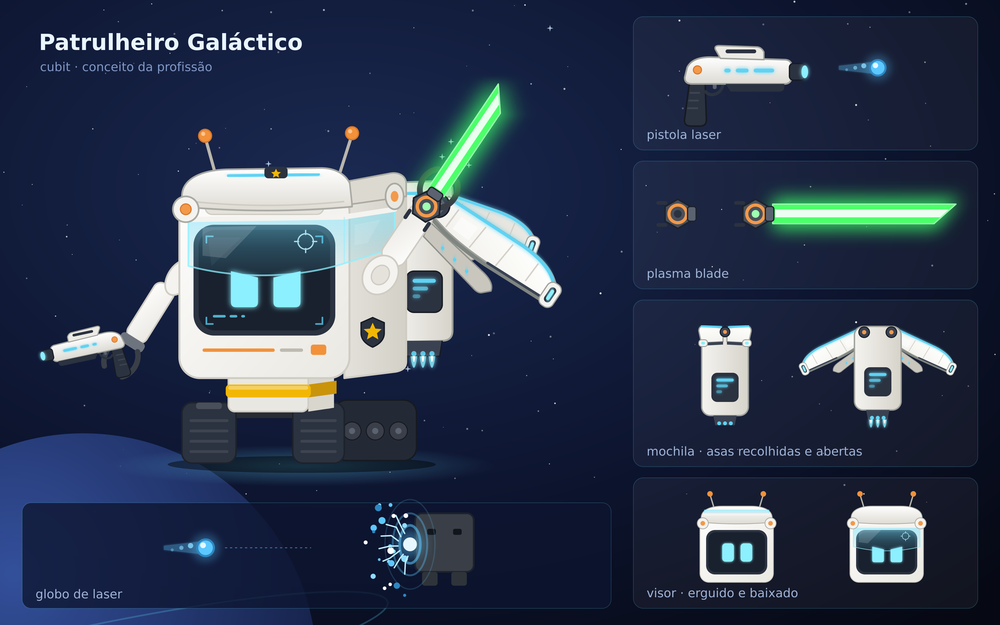

# Patrulheiro Galático

Conceito do trabalho de Patrulheiro Galático, que substitui o Defensor (#198). O documentado pode mudar se aparecer um impedimento técnico (regra 49 do `AGENTS.md`). Ele complementa [`trabalhos.md`](../trabalhos.md), cujas regras de toda área e a [base do trabalho](../trabalhos.md#base-do-trabalho) valem aqui, com as exceções escritas abaixo.

**Situação:** autorizado (perguntas 1591, 1613, 1632 e 1698). O conceito vem do desenvolvedor (perguntas 1550 a 1552) e foi refinado nas perguntas 1553 a 1697. O PR 1, com o comportamento, entrou no #238, o PR 2, com a rota e a ronda lenta, no #239, e o PR 3 traz o realismo e o visual. A prioridade é a mais alta, como a da Engineering Desk: cada detalhe do conceito e da aparência é decidido antes do código (pergunta 1560). Os números ficam em [`tiers.md`](../../tiers.md#trabalhos).

## A ideia

O Patrulheiro Galático é o Cubit nerd, fã de ficção científica, que leva a sério a missão de proteger o player e a base. Ele faz a ronda, procura hostis e ataca primeiro, de pistola laser numa garra e lâmina de plasma na outra.

Onde o Defensor só protegia uma área, o Patrulheiro também vai atrás: percorre uma rota, persegue o hostil até um limite, investiga onde ele sumiu e volta ao ponto mais próximo da ronda. Com o card, o Cubit bate mais forte e aguenta mais que um Cubit sem ele (pergunta 1552).

O visual é uma homenagem ao clima de aventura espacial, com design todo próprio: nenhuma peça copia personagem, arma ou marca de filme (regra 9). As asas abrem para trás, como uma asa-delta, e a lâmina sai direto da garra, sem cabo (perguntas 1553 e 1554).

## Imagem conceito

Aceita na pergunta 1592 como referência, com dois ajustes aplicados direto no modelo:

1. **Asas recolhidas:** deitadas sobre a mochila, com as pontas passando da borda de trás. No painel da mochila, elas não aparecem.
2. **Asas abertas:** mais para trás que para os lados, como na figura principal, e nunca no "V" invertido do painel da mochila (pergunta 1553).

O nome é "Galático", nos documentos e no jogo, e não "Galáctico", como no título da imagem.

## Card

| Nome | ID | Descrição |
|---|---|---|
| Machine Learning: Galactic Patroller | `cubit:ml_patroller` | Card de Aprendizado de Máquina do trabalho de Patrulheiro Galático. Em português, "Patrulheiro Galático" |

Segue as regras dos outros cards: slot exclusivo, um por Cubit, sai sem perda e só trabalha em área marcada (pergunta 1599). Disponível a partir do Elite, no lugar do Defensor (perguntas 1150, 1539 e 1563). Substitui `cubit:ml_defender` e o valor `defender` do `allowed_jobs`, que não foram publicados, sem migração (pergunta 1569).

### Receita

Sem forma, rendendo 1, como todos os cards: a Card Casing, a Circuit Board e uma estrela de fogo de artifício, que lembra o distintivo da estrela dourada. Libera com o Elite Module (perguntas 1544, 1546 e 1576).

## Como o player o põe para patrulhar

1. Põe o card no slot de um Cubit Elite ou Ultimate.
2. Com o app Área do Tablet, marca a área que ele guarda, que pode ter o dobro do lado da área dos outros cards: até 64×64 no Elite e 128×128 no Ultimate, com a altura do tier, de 24 e 32 blocos (perguntas 1600 e 1601). Sem área, ele segue o dono e faz a escolta (perguntas 1565 e 1599).
3. Com o app Marcar, marca os pontos da rota dentro da área, na ordem em que quer que ele passe (perguntas 1579 e 1599).
4. Sem pontos marcados, ele patrulha a área pelas bordas, no mesmo passo lento, parando em cada canto e a cada trecho de 12 a 20 blocos andados (perguntas 1561, 1616 e 1628).
5. Para guardar os drops, marca um baú com o app Descarga, como nos outros cards (pergunta 1570).

### A rota

- **Marcar:** com o card do Patrulheiro, o app Marcar marca o topo de qualquer bloco sólido dentro da área, na ordem dos cliques, até 16 pontos no Elite e 32 no Ultimate. O clique num ponto marcado o desmarca, e Shift + clique desmarca o ponto clicado ou, fora de um ponto, o último, como hoje. A ordem dos outros pontos se mantém (perguntas 1579 e 1611).
- **Avisos:** na barra de ação, sem área, `Mark the area first with the Area app`; fora da área, `Only inside the area of %s`; num bloco que não é sólido, `Mark the top of a solid block`; e ao marcar, `Point %s of %s marked for %s`, com o número do ponto, o limite e o nome do Cubit. Desmarcar, rota cheia e nenhum ponto usam os avisos de hoje do app Marcar (pergunta 1611).
- **Ver:** com o Tablet na mão e o app Marcar aberto, cada ponto da rota do Cubit escolhido mostra uma seta com o número da ordem, e uma linha ciano tracejada liga os pontos em laço. Só a rota do Cubit escolhido aparece, para os números de rotas diferentes não se misturarem (perguntas 1580 e 1612).
- **Ritmo:** ele percorre os pontos em laço, num passo de vigia, a 60% da velocidade normal. A perseguição e a volta à rota seguem na velocidade normal (pergunta 1614).
- **Paradas:** ele para em cada ponto e a cada trecho de 12 a 20 blocos andados no caminho, sorteado, e o contador zera a cada parada. Em cada parada, fica de 3 a 5 s, sorteados, vira a cabeça devagar para a esquerda e para a direita duas vezes, volta ao centro e retoma a caminhada. Um combate interrompe a parada (perguntas 1615, 1617, 1618 e 1628).
- **Guardar:** os pontos ficam salvos no NBT do Cubit, mesmo sem o card, e voltam a valer quando o card volta. Ao recolher o Cubit, eles se perdem, como a área e as marcas do Organizador (perguntas 1582 e 1602).
- **Chunks:** ele nunca entra em chunk descarregado. Um ponto num chunk descarregado é pulado até carregar de novo (regra 22).

## Combate

### Quem ele ataca

- **Modo:** só o Agressivo, enquanto tiver o card, porque atacar primeiro é a essência dele. A aba Defense mostra o modo travado como um modo bloqueado pelo tier: o Agressivo marcado, e o Pacífico e o Contra-atacar escurecidos, com `Locked by the Galactic Patroller card` no lugar do detalhe. Ao tirar o card, volta o modo que estava antes (perguntas 1566 e 1610).
- **Procura:** ataca, no raio de procura em volta de onde está, todo mob que pode ser hostil, mesmo calmo: todo `Enemy`, todo mob da categoria `MONSTER` de qualquer mod e todo `NeutralMob`, como o enderman e o piglin zumbificado (pergunta 1633).
- **Nunca ataca:** os protegidos, os golems de ferro e de neve, os mobs domesticados de alguém e os da água pacíficos, como o golfinho. Um piglin zumbificado atacado irrita o grupo contra o Cubit, como no jogo (pergunta 1633).
- **Casos de fronteira:** um animal que também é `Enemy`, como o hoglin, é alvo. Os animais neutros, como o urso-polar, a abelha e o lobo selvagem, ficam protegidos enquanto calmos e viram alvo quando miram num protegido ou estão bravos com o dono. O shulker é alvo, porque só o golem de ferro e o de neve ficam de fora (perguntas 1701 a 1703).
- **Mobs de outros mods:** ele os reconhece pelos sinais do jogo, sem lista fixa: a interface `Enemy`, a categoria `MONSTER` e a interface `NeutralMob`. Um mob que não tem nenhum deles vira alvo quando mira num protegido, e as tags corrigem o resto (perguntas 1633, 1634 e 1705).
- **Tags:** `cubit:patroller_targets` acrescenta mobs que ele sempre ataca, e `cubit:patroller_ignores`, mobs que ele nunca ataca. A de ignorar vence, e os protegidos nunca entram (pergunta 1634).
- **Protegidos:** o dono, os outros players, os robôs, os animais e os aldeões. Ele nunca os fere, e o globo e a lâmina passam por eles (perguntas 1558 e 1570).
- **Prioridade:** primeiro o mob que está ferindo alguém, depois o mais próximo de um protegido (pergunta 1568).
- **Vários Patrulheiros:** os do mesmo dono lutam juntos, como uma equipe (perguntas 1643 a 1646):
  1. **Mesmo alvo:** todos atacam o hostil de maior prioridade, um de cada vez, e só passam ao próximo quando ele cai ou sai do limite. Um hostil que passa a ferir alguém vira o alvo da equipe.
  2. **Chamado:** ao entrar em combate, um Patrulheiro avisa os outros do mesmo dono na mesma área ou a até 32 blocos. Áreas na mesma dimensão que se sobrepõem ou se encostam contam como a mesma (pergunta 1707). Quem não está lutando vem ajudar, mesmo com o hostil fora do próprio raio de procura, respeitando o próprio limite de perseguição. Na escolta, ele não deixa o dono para atender.
  3. **Cerco:** cada um se aproxima por um lado do hostil, espalhados em volta dele, e na pistola cada um mira de uma posição diferente. O globo atravessa os robôs, sem fogo amigo. A ordem é fixa: o primeiro mantém o lado de onde veio, e os outros se espalham em ângulos iguais. Na lâmina, cada um fica a 1,8 bloco do alvo; na pistola, mantém a própria distância, entre a troca de arma e o alcance. O recuo do creeper vem antes do cerco (pergunta 1718).
  4. **Ronda espaçada:** na mesma rota ou nas mesmas bordas, eles se espalham pelo laço, cada um partindo de um ponto diferente. O espaçamento vale ao começar a ronda e quando dois ficam no mesmo trecho: o que chegou depois vai ao ponto mais longe dos colegas. A volta depois do combate vai ao ponto mais perto, e o espaçamento se refaz no ponto seguinte (perguntas 1625 e 1708).
  5. **Uma fala por equipe:** no mesmo combate, só um deles fala ao entrar em combate e ao abater.
  6. **Socorro:** um Patrulheiro com a vida baixa em combate, abaixo do limite da [cautela](#vida-baixa), vira a prioridade da equipe. O hostil mais perto dele, a até 8 blocos, passa a ser o alvo de todos, acima de quem fere outro protegido, até não sobrar hostil nesse raio. Atendem os da mesma área ou a até 32 blocos, mesmo fora do próprio raio de procura, e, na escolta, nenhum deixa o escoltado (pergunta 1691).

### Vida baixa

Com a vida abaixo de 25%, ele luta com cautela: deixa o corpo a corpo, usa só a pistola, mantendo a distância da troca de arma, e recua para o lado do protegido mais próximo. Sem carga para atirar, usa a lâmina, para nunca ficar sem defesa. Volta ao normal quando a vida sobe, no Dock ou com a Recharge Splash (perguntas 1571 e 1686).

### Bola de fogo

Uma bola de fogo de ghast indo para um protegido vira alvo da pistola, e o globo a rebate, como o soco do player no jogo. Ele não desvia nem intercepta flechas: o atirador que mira num protegido já é o primeiro alvo (pergunta 1687).

### Perseguição

Ele sai da rota para ir atrás de um hostil até 16 blocos, medidos do ponto da rota mais perto do hostil ou, na ronda pelas bordas, da borda da área. Na escolta, mede do dono. Quando o alvo morre ou foge do limite, investiga e volta ao ponto mais próximo da ronda (seção [Realismo](#realismo)). Nunca entra em chunk descarregado (perguntas 1562, 1625, 1636 e regra 22).

### Realismo

O comportamento de um vigia de verdade, decidido no início do PR 3 (perguntas 1619 e 1623 a 1629):

1. **Alerta ao avistar:** ao ver um hostil, ele para por 0,5 s, vira o corpo e a cabeça para ele, baixa o visor com o bipe de mira travada e só então ataca. Se o hostil já estiver ferindo alguém, pula o alerta (pergunta 1623).
2. **Investigar:** quando o hostil some de vista ou foge do limite, ele anda até onde o viu por último, se estiver dentro do limite de perseguição, para olhando em volta, como numa parada da ronda, e só então volta. Se o hostil reaparecer, retoma o combate. O teleporte, como o do enderman e o do shulker, conta como sumir de vista: se o alvo reaparece no raio de procura, à vista e dentro do limite de perseguição, ele o retoma na hora, sem novo alerta (perguntas 1624 e 1694).
3. **Conferir o dono:** ao abater o último hostil por perto, com o dono a até 16 blocos, ele vira a cabeça para o dono por 1 s, antes de investigar ou voltar (pergunta 1629).
4. **Visor com calma:** depois do combate, o visor só sobe depois da investigação ou de 3 s sem ameaça (pergunta 1629).
5. **Volta à ronda:** volta ao ponto da rota mais perto de onde está e segue a ordem a partir dele. Na ronda pelas bordas, volta ao canto mais perto (pergunta 1625).
6. **Olhar para fora:** nas paradas das bordas, a varredura é feita de frente para fora da área e, nos cantos, de frente para a diagonal de fora. Nos pontos da rota, segue a direção em que andava (pergunta 1626).
7. **Guarda:** na parada, ele ergue um pouco o braço da pistola, apontada para onde olha, e o abaixa ao retomar a caminhada (pergunta 1627).
8. **Ritmo variado:** cada parada sorteia entre 3 e 5 s, e cada trecho, entre 12 e 20 blocos (pergunta 1628).
9. **Água:** ele nunca entra na água para perseguir. Contra um alvo na água, como o afogado e o guardião, atira da margem, com o alvo no alcance e à vista, e o globo não perde velocidade na água. Um alvo que só se alcança pela água, fora do alcance, conta como fugido, e ele investiga da margem. Se cair na água, luta de lá (pergunta 1693).
10. **Noite e chuva:** não mudam a ronda nem o combate. O bônus da noite fica para o DDoS (perguntas 1572 e 1692).

### Escolta

Seguindo o player, ele não patrulha, mas usa a pistola e a lâmina no lugar do choque para proteger o player, no modo Agressivo. A rota volta quando ele deixa de seguir. É a exceção à regra de que todo card age como generalista ao seguir (pergunta 1565).

### Escolta marcada

Além do dono, ele escolta quem o dono marcar no Tablet (perguntas 1655 a 1661):

1. **Marcar:** com o Patrulheiro escolhido, o app novo `Escort` do Tablet, "Escolta" em português, em dourado (pergunta 1662), que só aparece quando o Cubit escolhido tem o card do Patrulheiro (pergunta 1664), marca o escoltado com um clique num player ou num mob. Um clique nele de novo, ou Shift + clique, desmarca.
2. **Quem:** qualquer player, os protegidos (aldeões, animais e robôs) e os outros mobs que ele nunca ataca, como um golem ou um mob domesticado. Um mob que ele ataca não pode ser escoltado, e o Tablet avisa.
3. **Como:** segue o escoltado com as regras do seguir, com a distância, o teleporte quando fica longe e as asas, e o protege como protege o dono, com a perseguição medida dele. Andando, vira a cabeça para os lados de tempos em tempos. Quando o escoltado para, ele para e faz a varredura da parada.
4. **Prioridade:** a escolta marcada vence a ronda e o seguir o dono. Cada Patrulheiro escolta um por vez, e vários podem escoltar o mesmo, como equipe.
5. **Fim:** termina quando o dono desmarca, aperta o `Follow` do Tablet, ou quando o escoltado morre, muda de dimensão ou sai do mundo. Depois, ele volta à ronda da área ou ao dono.
6. **Save:** o escoltado fica no NBT do Cubit, em `EscortTarget`, e a escolta volta quando os dois estiverem carregados. Não vai para o item e se perde ao recolher o Cubit.
7. **Avisos:** com o app `Escort` aberto, uma seta na cor do app marca o escoltado de cada Patrulheiro do dono. Um player escoltado recebe na barra de ação `%s is escorting you` ao começar e `%s stopped escorting you` ao terminar.

### Choque

Com o card, a pistola e a lâmina fazem o papel do choque. Sem o card, o choque volta (pergunta 1556).

### Ataque e defesa maiores

Enquanto o card está no slot, o Cubit ganha armadura extra, pelo atributo do jogo, e as armas batem acima do choque do mesmo tier. O bônus sai junto com o card, e a vida do tier não muda (perguntas 1552, 1555 e 1577).

### Creeper

Contra o creeper, usa sempre a pistola, nunca a lâmina. Se o creeper começar a acender perto dele ou de qualquer protegido, ele recua até sair do raio da explosão, de 4 blocos, e volta a atirar (perguntas 1567 e 1641). Sem carga para atirar, ele não ataca o creeper: fica fora do raio, a 6 blocos, no caminho entre o creeper e o protegido mais próximo, como um escudo, e volta a atirar quando tiver carga (perguntas 1595 e 1641). Os dois números ficam no config (pergunta 1642).

## Armas

As duas armas são partes do modelo do Cubit com o card, sem item para o player (pergunta 1573). A pistola fica na garra esquerda e o emissor da lâmina no pulso direito, o tempo todo (pergunta 1574). Ele escolhe a arma sozinho, pela distância: a pistola a partir de 4 blocos e contra alvos no ar, e a lâmina mais perto (pergunta 1557). Como no jogo, o globo conta como projétil: o enderman desvia dele teleportando, e os mobs da tag `minecraft:deflects_projectiles`, como o breeze, o rebatem, sem nunca ferir um protegido. Contra eles, ele usa só a lâmina, mesmo a mais de 4 blocos, com o salto quando o alvo está no ar (perguntas 1695 e 1696).

### Pistola laser

- **Forma:** branca, com o cano em ciano, faixas de energia acesas no corpo e um botão laranja.
- **Disparo:** um globo de laser azul, da cor dos olhos do Cubit, que voa em linha reta, sem gravidade, e acerta só o mob atingido (pergunta 1558).
- **Estouro:** ao acertar, estoura em partículas azuis, como uma poção de arremesso, lembrando uma explosão magnética. O estouro é só visual e nunca quebra blocos (perguntas 1551 e 1558).
- **Lentidão:** cada acerto tem 20% de chance de deixar o alvo lento (pergunta 1551).
- **Energia:** cada disparo gasta bateria. Sem carga para atirar, ele usa só a lâmina (pergunta 1571).

### Plasma Blade

- **Forma:** sem cabo. Um emissor hexagonal preso ao pulso, com um anel laranja, projeta a lâmina verde direto da garra, um pouco mais larga e com a ponta em cunha (pergunta 1554). O nome no jogo é "Plasma Blade", e nunca "sabre de luz".
- **Acende:** a lâmina acende, com som, só no combate de perto, e apaga depois (pergunta 1574).
- **Empurrão:** cada golpe empurra o alvo para trás (pergunta 1551).
- **Cabeça:** ao matar um mob que tem cabeça no jogo (zumbi, esqueleto, creeper, piglin e wither skeleton), 50% de chance de derrubar a cabeça. Os outros hostis não derrubam nada a mais, e a cabeça vai para o inventário do Cubit, como os outros drops (pergunta 1559).
- **Energia:** a lâmina não gasta bateria, para ele nunca ficar sem defesa (pergunta 1571).

## Asas

- **Abrem:** na queda e no salto, para trás e para baixo, como uma asa-delta, com os propulsores acesos. Fecham ao tocar o chão (pergunta 1553).
- **Planar:** na queda, ele plana, sem dano de queda e sem gastar bateria (perguntas 1564 e 1571).
- **Salto:** só no combate, para um alvo no ar ao alcance da altura do salto, quando a pistola não pode atirar, sem carga ou fora do alcance. Ele golpeia com a lâmina no ar. Com carga, atira de baixo e não salta. O Ultimate salta mais alto, e cada salto gasta bateria (perguntas 1564 e 1596).
- **Mobs voadores:** a pistola alcança a maior parte, e o salto aproxima o Cubit de um Phantom ou de um Blaze para a lâmina quando a pistola não pode atirar (pergunta 1596).
- **Pulo de asa:** quando o caminho a pé não existe ou tem mais que o dobro da distância em linha reta (pergunta 1651), ele abre as asas e pula por cima de cercas, muros e blocos até a altura do salto do tier, de 3 e 5 blocos, com a energia do salto. Precisa de espaço livre acima e de chão seguro do outro lado. Sem carga, contorna (pergunta 1647).
- **Vãos:** atravessa vãos de até 4 blocos no Elite e 6 no Ultimate, saltando e planando até o outro lado, no mesmo nível ou abaixo, com a energia do salto. Um vão maior, ele contorna (pergunta 1648).
- **Descida:** quando o destino está abaixo de uma beirada, salta e desce planando, sem gastar energia (pergunta 1649).
- **Pouso seguro:** nunca pula nem plana para lava, fogo, água funda ou bloco que fere (perguntas 1647 a 1649).
- **Quando:** na ronda, na perseguição, na investigação, na volta à ronda e na escolta, para acompanhar quem ele segue, com o teleporte do seguir quando fica longe. Nunca usa as asas para sair da área fora de uma perseguição (perguntas 1650 e 1654).
- **Luzes:** com as asas em uso, o LED da borda da frente e as três luzes da aleta acendem em azul, da cor dos olhos do Cubit, junto com os propulsores. Recolhidas, ficam apagadas (pergunta 1653).

## Bateria

- **Retorno:** com o card, o retorno automático vale com 5% da bateria no Elite e 3% no Ultimate, no lugar da carga do tier. Ele termina o combate antes: espera não haver ameaça no raio de procura e vai direto ao Dock, sem investigar, também na escolta (perguntas 1688 e 1689).
- **Aviso:** na barra de ação do dono, com o nome do Cubit, `%s is low on power, heading to the Dock` ("%s está com pouca energia, indo ao Dock") e, sem Dock por perto, `%s is low on power and has no Dock` ("%s está com pouca energia e sem Dock"). Respeita a chave `Chatter`. Com o card, ele substitui o `I need to recharge` do retorno automático (perguntas 1690 e 1699).

## Drops e descarga

- **Drops:** os drops de um mob que ele abate vão direto para o inventário dele, como a cabeça, enquanto couberem, sem depender do ímã nem do filtro de coleta. O resto cai no chão (perguntas 1570 e 1635).
- **Abate do dono:** o abate conta como do dono, que ganha o XP e os drops que só caem quando um player mata, como se tivesse lutado (pergunta 1637).
- **Sem hibernar:** nunca hiberna por inventário cheio. Com o inventário cheio, segue protegendo, e os drops caem no chão. Só para sem bateria (perguntas 1570 e 1639).
- **Descarga:** com baú marcado no app Descarga, descarrega quando não há ameaça. Um combate interrompe a ida ao baú e a busca de um item no chão, que voltam depois, e ele não começa uma descarga com um hostil no raio de procura (perguntas 1570 e 1640).

## Evolução por tier

Os números ficam em [`tiers.md`](../../tiers.md#trabalhos), todos no config (pergunta 1577).

| Recurso | Elite | Ultimate |
|---|---|---|
| Pistola: dano | 5 | 7 |
| Pistola: alcance | 16 blocos | 24 blocos |
| Pistola: intervalo | 1 s | 0,6 s |
| Pistola: custo por disparo | 1.000 FE | 800 FE |
| Lentidão, com 20% de chance | I, por 3 s | II, por 3 s |
| Lâmina: dano | 7 | 10 |
| Lâmina: intervalo | 0,6 s | 0,5 s |
| Lâmina: empurrão | Médio | Forte |
| Lâmina: alcance do golpe | 2,5 blocos | 2,5 blocos |
| Cabeça, ao matar com a lâmina | 50% | 50% |
| Armadura extra | +6 | +10 |
| Raio de procura | 16 blocos | 24 blocos |
| Perseguição máxima | 16 blocos | 16 blocos |
| Troca de arma | 4 blocos | 4 blocos |
| Salto: altura | 3 blocos | 5 blocos |
| Salto: custo | 500 FE | 400 FE |
| Vão que atravessa planando | 4 blocos | 6 blocos |
| Pontos da rota | 16 | 32 |
| Lado da área | 64 blocos | 128 blocos |
| Velocidade da ronda | 60% | 60% |
| Parada | 3 a 5 s | 3 a 5 s |
| Blocos até a próxima parada | 12 a 20 | 12 a 20 |
| Alerta ao avistar | 0,5 s | 0,5 s |
| Investigação | 3 a 5 s | 3 a 5 s |
| Vida da cautela | Abaixo de 25% | Abaixo de 25% |
| Raio do socorro | 8 blocos | 8 blocos |
| Retorno automático | 5% | 3% |

## Visual

| Peça | Como é |
|---|---|
| Capacete | Branco, cobre o topo da cabeça e desce pela lateral. Tem um filete ciano, a estrela dourada no alto e uma dobradiça de cada lado, com o centro laranja das antenas. As antenas saem por cima dele |
| Visor | Lente ciano translúcida, presa às dobradiças, que se curva pela frente e pela lateral. Baixado, cobre o alto da tela e mostra uma mira. Erguido, fica recolhido no topo do capacete |
| Tela | Com o visor erguido, os olhos normais do Cubit. Com o visor baixado, olhos decididos e marcas de mira nos cantos |
| Mochila | Branca, com um filete ciano no topo, um painel escuro com barras de carga atrás e três propulsores embaixo |
| Asas | Saem da mochila por uma dobradiça mecânica escura com centro laranja. Cada asa tem a lâmina principal varrida para trás, com a borda da frente curva, a de trás reta e uma espessura escura embaixo; um LED na borda da frente; painéis divididos por linhas finas; uma aleta cinza embaixo, com três luzes; as luzes ficam apagadas com as asas recolhidas e acendem em azul, da cor dos olhos, com as asas em uso (pergunta 1653); e uma cápsula branca com janela ciano na ponta. Recolhidas, ficam deitadas sobre a mochila. Abertas, vão para trás e para baixo, como uma asa-delta (pergunta 1553) |
| Pistola | Na garra esquerda, branca, com cano ciano, faixas de energia acesas e um botão laranja |
| Plasma Blade | No pulso direito, o emissor hexagonal com anel laranja. A lâmina verde, larga e com ponta em cunha, sai direto da garra (pergunta 1554) |
| Distintivo | Escudo escuro com a estrela dourada, na lateral do corpo |
| Coleira | A cor do tier, como nas outras profissões |

### Combate e patrulha

- **Alerta:** ao avistar um hostil, ele vira para ele, e o visor desce com o bipe de mira travada (pergunta 1623).
- **Combate:** com o visor baixado, os olhos ficam decididos, e a lâmina acende quando o alvo chega perto. O player vê o modo de combate só de olhar para ele.
- **Depois do combate:** confere o dono com a cabeça, investiga o último local, e o visor só sobe depois da investigação ou de 3 s sem ameaça (perguntas 1624 e 1629).
- **Patrulha:** com o visor erguido, ele percorre a rota no passo de vigia, e nas paradas ergue a pistola em prontidão, apontada para onde olha (perguntas 1614 e 1627).
- **Asas em uso:** abertas, com os propulsores e as luzes azuis acesos (pergunta 1653).

## Falas

Como todas as profissões, ele fala uma de três frases ao receber o card e frases próprias ao entrar em combate e ao abater um hostil, como um herói espacial e um cavaleiro sereno, sem citar filmes. As frases e as regras estão em [`falas.md`](../../conceito/falas.md#profissões) (perguntas 1583 a 1590).

## Sons

Sons próprios em `.ogg`, descritos em [`sons.md`](../../conceito/sons.md#patrulheiro-galático): o agente descreve cada um, com a duração e o clima, o desenvolvedor fornece os `.wav`, e o agente os trata (pergunta 1575).

## Fora do escopo

- **DDoS e Firewall:** o conceito original cita o "time do mal", que aparece à noite, e o Firewall. Eles não estão no roadmap, e o Patrulheiro não depende deles. Um bônus à noite e a combinação com o Firewall ficam para quando esses cards forem planejados (pergunta 1572 e regra 43).
- **Armas para o player:** a pistola e a lâmina não viram itens (pergunta 1573).

## Contrato

| Onde | Nome | Conteúdo |
|---|---|---|
| Item | `cubit:ml_patroller` | O card, na tag `cubit:ml_cards`. Substitui `cubit:ml_defender`, que não foi publicado (pergunta 1569) |
| Receita | `cubit:ml_patroller` | Card Casing, Circuit Board e estrela de fogo de artifício, liberada pelo Elite Module (pergunta 1576) |
| Config, `allowed_jobs` | `patroller` | No lugar de `defender`, no Elite e no Ultimate (pergunta 1569) |
| Config, por tier | `patroller_pistol_damage`, `patroller_pistol_range`, `patroller_pistol_interval_ticks`, `patroller_pistol_cost`, `patroller_slowness_level`, `patroller_blade_damage`, `patroller_blade_interval_ticks`, `patroller_blade_knockback`, `patroller_armor`, `patroller_search_radius`, `patroller_jump_height`, `patroller_jump_cost`, `patroller_route_points`, `patroller_area_size`, `patroller_blade_reach`, `patroller_gap_distance` e `patroller_return_charge_percent` | Os números por tier da tabela acima (perguntas 1642, 1648 e 1689) |
| Config, geral | `patroller_slowness_chance`, `patroller_slowness_ticks`, `patroller_head_chance`, `patroller_chase_distance`, `patroller_weapon_switch_distance`, `patroller_patrol_speed`, `patroller_stop_min_ticks`, `patroller_stop_max_ticks`, `patroller_stop_min_distance`, `patroller_stop_max_distance`, `patroller_alert_ticks`, `patroller_owner_check_ticks`, `patroller_owner_check_distance`, `patroller_visor_calm_ticks`, `patroller_creeper_blast`, `patroller_keep_away`, `patroller_search_interval_ticks`, `patroller_blade_knockback_base`, `patroller_blade_knockback_step`, `patroller_call_range`, `patroller_wing_detour_factor`, `patroller_low_health_percent` e `patroller_rescue_radius` | 20%, 3 s, 50%, 16 blocos, 4 blocos, 0,6, 3 s, 5 s, 12 blocos, 20 blocos, 0,5 s, 1 s, 16 blocos, 3 s, 4 blocos, 6 blocos, 0,5 s, 0,4, 0,5, 32 blocos, 2, 25% e 8 blocos (perguntas 1614 a 1618, 1632, 1642, 1644, 1651, 1686 e 1691) |
| NBT da entidade | `PatrolRoute` | Os pontos da rota, em ordem. Sem a chave no save, a rota é vazia. Não vai para o item (perguntas 1582 e 1602) |
| Entidade | `cubit:laser_orb` | O globo de laser da pistola |
| Tags de entidade | `cubit:patroller_targets` e `cubit:patroller_ignores` | Os mobs que ele sempre ataca e os que nunca ataca, vazias no mod (pergunta 1634) |
| Tipos de dano | `cubit:laser_orb` e `cubit:plasma_blade` | O dano das duas armas, com as mensagens de morte em inglês e em português |
| Tag de tipo de dano | `minecraft:is_projectile` | Recebe `cubit:laser_orb`, para o globo contar como projétil no jogo (pergunta 1695) |
| Traduções | Os avisos da bateria | `%s is low on power, heading to the Dock` e `%s is low on power and has no Dock`, em inglês e português (pergunta 1690) |
| App do Tablet | `escort` | O app Escort, só com o Patrulheiro escolhido (pergunta 1655) |
| NBT da entidade | `EscortTarget` | O UUID do escoltado. Sem a chave, não há escolta. Não vai para o item (pergunta 1659) |
| Pacote do servidor | `cubit:patrol_route` | Os pontos da rota do Cubit escolhido no Tablet, para as setas e a linha do app Marcar (pergunta 1612) |
| Sons | Os eventos de `sons.md` | Disparo, estouro, lâmina, golpe, asas e visor |
| Config, geral | `job_chatter_chance`, `job_chatter_interval_ticks` e `job_chatter_range` | As falas de todas as profissões: 20%, 2 min e 32 blocos (perguntas 1585 e 1586) |
| Traduções | As frases de `falas.md` | As falas de entrada e do trabalho das cinco profissões, em inglês e português |

## Entrega

Uma issue, a #198 renomeada, e três PRs testados no jogo (perguntas 1578, 1605 e 1630):

1. **Comportamento:** as falas das cinco profissões, o card, a troca do Defensor, os tiers dos trabalhos, a ronda pelas bordas da área, a perseguição, os alvos, a escolta, o modo Agressivo no servidor, as armas com o dano, a lentidão, o empurrão e a cabeça, a armadura, o gasto, o planar, o salto, a receita e os GameTests, com um visual provisório.
2. **Rota:** o modo travado na aba Defense, com o motivo, a rota no app Marcar, com as setas numeradas, a linha tracejada e o pacote `cubit:patrol_route`, e os GameTests da rota.
3. **Visual e realismo:** o realismo da seção [Realismo](#realismo), os alvos novos, a equipe de Patrulheiros, as asas para se mover, a escolta marcada, as correções das perguntas 1635 a 1642, o refinamento final das perguntas 1685 a 1697, o modelo, as texturas, as animações, os efeitos e os sons, a partir das imagens e dos `.wav` aprovados.

## Histórico de modificações

| Pessoa | Data e hora | Modificação |
|---|---|---|
| Zennd | 2026-11-22 17:10 | Detalha o cerco da equipe (pergunta 1718). |
| Zennd | 2026-11-22 16:30 | Atualiza a numeração das regras do `AGENTS.md` (pergunta 1716). |
| Zennd | 2026-11-22 15:30 | Detalha a mesma área do chamado e a ronda espaçada (perguntas 1707 e 1708). |
| Zennd | 2026-11-22 15:10 | Acrescenta os casos de fronteira dos alvos (perguntas 1701 a 1703 e 1705). |
| Zennd | 2026-11-22 14:50 | Acrescenta a vida baixa, o socorro, a bola de fogo, a bateria, a água, a noite, o teleporte, o enderman e o breeze (perguntas 1685 a 1699). |
| Zennd | 2026-11-22 13:00 | Confere o documento com as respostas 1550 a 1665, com o app Escort só com o card e o visual do alerta, da guarda e das asas (perguntas 1664 e 1665). |
| Zennd | 2026-11-22 12:35 | Acrescenta a escolta marcada pelo app Escort (perguntas 1655 a 1661). |
| Zennd | 2026-11-22 12:25 | Acrescenta as luzes azuis das asas e as asas na escolta (perguntas 1653 e 1654). |
| Zennd | 2026-11-22 12:15 | Acrescenta o pulo de asa, os vãos e a descida planando (perguntas 1647 a 1650). |
| Zennd | 2026-11-22 12:05 | Troca a reserva de alvos pela equipe de Patrulheiros (perguntas 1643 a 1646). |
| Zennd | 2026-11-22 11:55 | Confere o conceito com o código e registra os drops, a perseguição, o abate, a hibernação, a descarga, o creeper e os números no config (perguntas 1635 a 1642). |
| Zennd | 2026-11-22 11:40 | Amplia os alvos a todo mob que pode ser hostil, com as tags (perguntas 1633 e 1634). |
| Zennd | 2026-11-22 11:30 | Troca as chaves da ronda pelas do ritmo variado e acrescenta as do realismo (pergunta 1632). |
| Zennd | 2026-11-22 11:20 | Acrescenta o realismo do PR 3 e o ritmo variado da ronda (perguntas 1623 a 1630). |
| Zennd | 2026-11-22 11:00 | Troca a pausa nos pontos pela ronda lenta, com paradas nos pontos, nos cantos e a cada 16 blocos (perguntas 1614 a 1618). |
| Zennd | 2026-11-22 10:40 | Atualiza a situação do conceito (pergunta 1613). |
| Zennd | 2026-11-22 09:50 | Detalha a aba Defense travada, os cliques e os avisos do app Marcar e a rota só do Cubit escolhido (perguntas 1610 a 1612). |
| Zennd | 2026-11-22 09:30 | Divide a entrega em três PRs (pergunta 1605). |
| Zennd | 2026-11-22 08:40 | Deixa a rota só no NBT, sem o componente do item (pergunta 1602). |
| Zennd | 2026-11-22 08:10 | Dobra o lado da área do Patrulheiro (pergunta 1600). |
| Zennd | 2026-11-22 08:08 | Registra o creeper sem carga, o salto, a área obrigatória e o tier dos trabalhos (perguntas 1595 a 1599). |
| Zennd | 2026-11-21 23:22 | Acrescenta a imagem conceito aceita, com os ajustes das asas (pergunta 1592). |
| Zennd | 2026-11-21 23:30 | Cria o conceito do Patrulheiro Galático, no lugar do Defensor, a partir do conceito do desenvolvedor (perguntas 1550 a 1599). |
